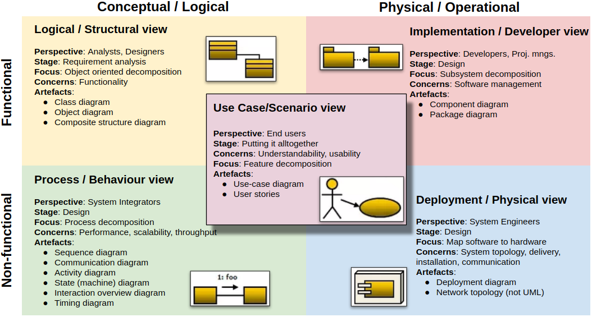
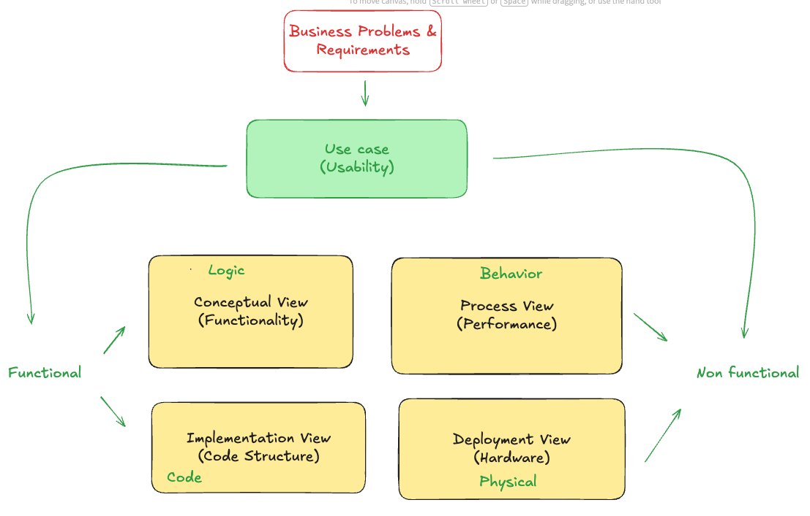

# 4 + 1 Architecture

- [Collecting use cases](#collecting-use-cases)
- [Breakdown a use case](#break-down-a-use-case)
- [Estimate project with use cases](#estimate-project-with-use-cases)
  - [Method 1: The Simple Complexity Matrix (Recommended for standard web apps)](#method-1-the-simple-complexity-matrix-recommended-for-standard-web-apps)
  - [Method 2: Detailed Breakdown (Task Slicing per Use Case)](#method-2-detailed-breakdown-task-slicing-per-use-case)
  - [Method 3: Formal Use Case Points (UCP) Method](#method-3-formal-use-case-points-ucp-method)

- [Tools](#tools)





Per 4 + 1 Architecture Framework, we have the following views:

- Scenarios (Use Case) : validation / requirements - story
- Logical (Conceptual) : functionality / domain - logic
- Process : concurrency / performance - behavior
- Development (Impl.) : code structure / modules - code
- Physical (Deployment) : hardware / infrastructure - physical

```sh
Per Kruchten's 4+1 Architecture View Model:

- Scenarios (Use Case)   : validation / requirements - story
- Logical (Conceptual)   : functionality / domain    - logic
- Process                : concurrency / performance - behavior
- Development (Impl.)    : code structure / modules  - code
- Physical (Deployment)  : hardware / infrastructure - physical

Story ──┬──> Logic
        ├──> Behavior
        ├──> Code
        └──> Physical
```

- Scenarios: Tell you what behavior to build and what your tests need to prove.
- Logical: Tells you which domain models, classes, and interfaces to write.
- Process: Tells you how to handle concurrency, queues, timeouts, and state inside your functions.
- Physical: Tells you what infrastructure realities your code must respect (e.g., keeping services stateless, because they run in auto-scaling containers, or writing to S3 instead of local disk).
- Development: Tells you where to put the files, which repo/service owns the code, and what shared libraries to use.

> Production Software = Iterate Slices of: Story ──> (Logic + Behavior + Code Structure + Physical)

> Vertical slice = Story ──> [ Logic + Behavior + Code Structure + Physical ] ──> Working Code

### Pre coding

- Story (Scenarios): What user journey are we building, and how do we test it?
- Logic (Logical): Which domain models, interfaces, and business rules are needed?
- Behavior (Process): How does it execute at runtime (async queues, concurrency, timeouts)?
- Code Structure (Development): Where do the files live (repo boundaries, modules, shared libs)?
- Physical (Deployment): What infrastructure rules apply (stateless containers, cloud storage, network limits)?

## Collecting use cases

### 1. Step 1: Identify All Actors & Stakeholders

Start by listing who interacts with the system, directly or indirectly. Different roles have different goals.

Keys: Who, direct/indirect, roles

- Primary actors : direct users
- Secondary actors: system/external

### 2. Step 2: Extract Goals from Business Domains (Domain Decomposition)

Group your system into **logical functional areas (domains)**. For each domain, ask: **"What goals must each actor achieve here?"**

Eg:

1. Data Onboarding & Migration

- Import bulk records from Google Sheets / CSV.
- Export system data to Excel / CSV.

### 3. Step 3: Use Discovery Techniques to Uncover Hidden Scenarios

- Data : who, when can update, who can reads,...
- Event storming/Process Mapping. Eg: for employee Hire -> Onboard -> Promote -> Offboard
- Stake holder interviews: manual time spent, answers need to have

### 4. Step 4: Map Interactions to a Matrix ( Actor vs Domain )

Eg:

1. Import Data

- [x] HR Admin : UC-01 Bulk Import
- [ ] BOD
- [ ] Line Manager
- [ ] Employee

2. View Profile

- [x] HR Admin : UC-02: Full Profile
- [x] BOD : UC-02: Full Profile
- [x] Line Manager : UC-03: Team Profile
- [x] Employee: UC-04: Own Profile

### 5. Step 5: Filter and Refine (Use Case Criteria Check)

Before adding a item to your final use case list, apply these 3 questions:

1. Does it produce a complete, measurable result for the user?

- Filtering by department $\rightarrow$ Step in a search use case (Not a standalone use case).
- Searching and exporting a talent report $\rightarrow$ Use Case.

2. Is it functional, not purely UI mechanics?

- Clicking a dropdown $\rightarrow$ UI action.
- Managing employee skill tags $\rightarrow$ Use Case.

3. Is it bounded?

- If a single use case spans across hiring, payroll calculation, and offboarding, break it down into separate smaller use cases.

## Break down a use case

### 1. Step 1: Deconstruct into Core Components

Every fully decomposed use case should be broken down into six main elements:

1. Basic Flow ( Happy Path ): the primary step-by-step path when everything goes right.
2. Alternate Flows: secondary standard branches (eg: optional steps, different input models)
3. Exception Flows(Error Paths): What happens when something fails(e.g: validation error, permission denied)
4. Pre-conditions: requirements that must be true before scenario begins
5. Post-conditions: System state changes after successful execution
6. Data Specifications: Field validation, access permissions, and data constraints

### 2. Step 2: Slice into User Stories / Tasks

If a use case is too large to implement in a single iteration or sprint, break it down using standard slicing techniques:

- By Action (CRUD): Separate Create, Read, Update, and Delete logic.
- By Role / Permission: Separate views and actions for HR, BOD, and standard Employees.
- By Sub-system / Interface: UI logic vs. Backend validation vs. External integrations (e.g., Google Sheet parser).
- By Data Field Depth: Core fields first (Basic info) $\rightarrow$ Extended history later (Salary/Certifications).

### Concrete Breakdown Example: UC-01: Import Employee Spreadsheet

**Metadata**

- Use Case ID: UC-01
- Name: Import Initial Employee Data
- Actor: HR Admin
- Pre-condition: User is logged in with HR Admin privileges; Google Spreadsheet/CSV file is ready.
- Post-condition: Valid employee records are created in the database; import execution log is generated.

**Detailed Flow Breakdown**

> Happy Path

```md
[Start] ──> Step 1: Upload File ──> Step 2: Validate Data ──> Step 3: Map Columns ──> Step 4: Persist Data ──> [Finish]
```

> Exception Flows

```md
# E-1 (Invalid File Structure)

[Start] ──> Step 1: Upload File ──> Step 2: Validate Data ──> E-1 (Invalid File Structure) : If file is corrupted or missing required columns, system aborts and shows error: "Invalid format: 'Full Name' column missing."
```

```md
# E-2 (Partial Validation Failure)

[Start] ──> Step 1: Upload File ──> Step 2: Validate Data ──> E-2 (Partial Validation Failure) : If row 12 has an invalid email or negative salary:

- System skips row 12 and logs the specific error.
- System imports valid rows (1–11, 13–50).
- System generates an Error Download CSV detailing failed rows and reasons.
```

**Map to BDD Scenarios & Engineering Deliverables**

**AC ( Acceptance Critera)**

```feature
# Acceptance Criteria for UC-01 (Partial Failure)
Scenario: Partial failure during spreadsheet import
  Given an HR Admin uploads a spreadsheet with 50 records where 2 rows have invalid dates
  When the import process runs
  Then 48 valid employee profiles should be created in the database
  And the system should provide an downloadable error report detailing the 2 failed rows
```

**Technical task break down**

Technical Task Breakdown (Jira/Board):
├── [Frontend] Build drag-and-drop file upload UI with parsing progress bar
├── [Backend] Create CSV/Excel parsing module and schema validator
├── [Backend] Write transactional bulk-insert database service with batching
└── [QA] Draft test files containing edge cases (blank rows, duplicate emails, invalid dates)

## Estimate project with use cases

### Method 1: The Simple Complexity Matrix (Recommended for standard web apps)

#### Simple

- Characteristics: Single entity, standard CRUD, basic validation, minimal permission checks. (e.g., View own basic profile)
- Typical Effort (Days / Hours): 1-2 days (8-16 hours)

#### Medium

- Characteristics: Multi-entity view/form, background processing, search/filtering, basic role permissions. (e.g., Update Work History, Advanced Directory Search)
- Typical Effort (Days / Hours): 3 – 5 days (24–40 hrs)

#### Complex

- Characteristics: Bulk operations, file parsing/validation, complex role-based data masking, workflow state machines, reporting/exporting. (e.g., UC-01 Spreadsheet Bulk Import, UC-02 360° Profile with access controls).
- Typical Effort (Days / Hours): 5 – 10+ days (40–80+ hrs)

### Method 2: Detailed Breakdown (Task Slicing per Use Case)

To get a precise estimate, take a fully broken-down use case (with main flows and exception flows) and estimate the sub-tasks.
Eg:

- Frontend UI: Drag-and-drop file uploader, mapping preview screen, progress bar, error log download modal ( 2 days )
- Backend Parsing & Validation: CSV/Excel parser, schema validator (missing fields, duplicate email, invalid dates), bad row error handler. ( 3 days )
- Database & Business Logic: Transactional bulk insert (batch processing), handling partial failures without corrupting state. ( 2 days )
- Testing & Edge Cases: End-to-end testing with real production-like spreadsheets (500+ rows, malformed data). ( 1.5 days)
- Buffer / Review: Code review, deployment, and bug fixes.( 1.5 days )

Total Estimate: 10 days

### Method 3: Formal Use Case Points (UCP) Method

If you need a formal mathematical estimation for contracts or executives, the Use Case Points (UCP) method calculates effort based on:

**Unadjusted Use Case Weight (UUCW):**

- Simple Use Case: 1–3 transactions (3 points)
- Average Use Case: 4–7 transactions (10 points)
- Complex Use Case: 8+ transactions (15 points)

**Unadjusted Actor Weight (UAW):**

- Simple Actor: Interacts via API/System (1 point)
- Average Actor: Interacts via CLI or structured protocol (2 points)
- Complex Actor: Interacts via Web GUI (3 points)

**Total Effort Calculation:**

$$\text{UCP} = (\text{UUCW} + \text{UAW}) \times \text{Technical Factor (TCF)} \times \text{Environmental Factor (EF)}$$

$$\text{Estimated Hours} = \text{UCP} \times 20 \text{ hours}$$

## Logical View

- Input: Requirements, use cases, domain knowledge
- Method: Object-oriented decomposition
- Output: Class, object, composite structure diagrams

### Object-oriented decomposition

## Tools

### Using BDD with Gherkin

[BDD Example](./examples/bdd-example.feature)

### Diagram and Flowchart in markdown

[Markdown Preview Mermaid Support](https://marketplace.visualstudio.com/items?itemName=bierner.markdown-mermaid)
