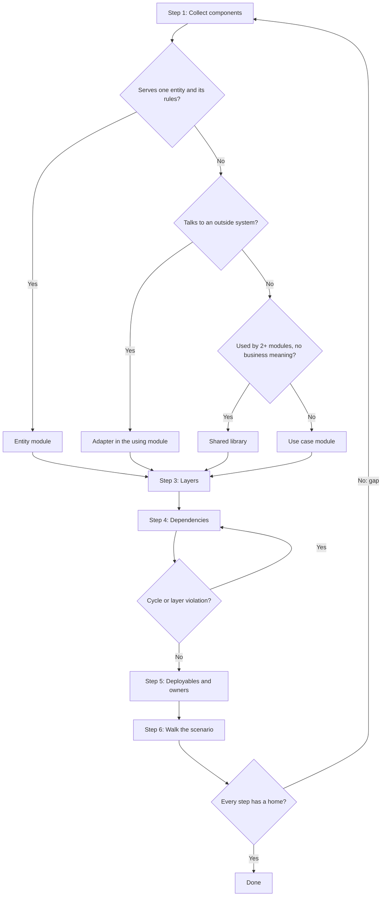

# Development View Guide (4+1 Architecture)

A working guide for building the **Development view** from use cases, the logical model, and the process view, with ready-to-copy templates for the **component inventory**, **module catalog**, **dependency rules**, **decision log**, and **traceability matrix**.

---

## 1. Purpose and scope

| Item                    | Description                                                                                                   |
| ----------------------- | ------------------------------------------------------------------------------------------------------------- |
| **View**                | Development / Implementation                                                                                  |
| **Question it answers** | Where does the code live, who owns it, and which module may depend on which?                                  |
| **Perspective**         | Developers, build and release engineers, team leads                                                           |
| **Concern**             | Software management, reuse, team organization, build and test                                                 |
| **Input**               | Use cases (+1 Scenario view), logical view (entities), process view (runtime units), team structure           |
| **Output**              | Module and layer diagram, dependency rules, folder layout, ownership, decision log, traceability              |
| **Not covered here**    | Entities and relationships (Logical view), runtime behavior (Process view), servers and networks (Physical view) |

The development view shows **how the code is organized**, not what the system stores or where it runs.

---

## 2. Workflow overview

| Phase | Activity                                                       | Where it is done          | Output                         |
| ----- | -------------------------------------------------------------- | ------------------------- | ------------------------------ |
| 1     | Steps 1 and 2: collect components, group into modules          | Notes (Markdown tables)   | Component inventory, modules   |
| 2     | Steps 3 and 4: layers, dependencies                            | Mermaid diagram, notes    | Module dependency diagram      |
| 3     | Step 5: deployables, repositories, owners                      | Notes                     | Deliverable and ownership table |
| 4     | Create the folder skeleton and the dependency check            | Repository, lint config   | Enforced structure             |
| 5     | Step 6: walk the scenario and the new file test                | Traceability table        | Use case steps linked to modules |
| 6     | Finalize catalog, decision log, traceability                   | `docs/architecture/`      | Documentation set              |

> **Rule:** write each decision into the decision log **at the moment you make it**. Tidy it in phase 6, but do not wait until then to write it.

---

## 3. The six-step method

### Step 1: Collect components

Take components from the logical view (entities), use case verbs, process view runtime units, screens, and external systems. Do not group yet.

### Step 2: Group into modules

Ask in order. Stop at the first question that decides it.

| #   | Question                                                           | If yes                                    | If no    |
| --- | ------------------------------------------------------------------ | ----------------------------------------- | -------- |
| 1   | Does it exist to serve one entity and its rules?                   | That entity's **module**                  | Continue |
| 2   | Does it change for the same reason as a component already grouped? | **Same module**                           | Continue |
| 3   | Does it talk to an outside system?                                 | **Adapter** inside the module that uses it | Continue |
| 4   | Used by two or more modules, no business meaning?                  | **Shared library**                        | Continue |
| 5   | Otherwise                                                          | Module of the use case it implements      |          |

**Rule of thumb:** a module is code that changes together and that one team can own.

### Step 3: Assign layers

| Layer              | Contains                                  | May depend on             |
| ------------------ | ----------------------------------------- | ------------------------- |
| **Presentation**   | Controllers, screens                      | Application               |
| **Application**    | Use case services, job handlers           | Domain                    |
| **Domain**         | Entities, rules, enumerations             | Nothing                   |
| **Infrastructure** | Database, file storage, external clients  | Domain                    |

Dependencies point inward. The domain layer imports no framework.

### Step 4: Define dependencies

For each module pair: who calls whom, through what (public API only), is there a cycle? Remove cycles by moving code, merging modules, or publishing an event.

### Step 5: Map to deployables, repos, and owners

Default for a small team: one repository, a modular monolith, several entry points (API, worker, scheduler). Split into services only for a reason from the process or physical view.

### Step 6: Walk the scenario (the +1 check)

For every use case step and exception flow, point at the module and layer. Anything you cannot place is a **gap**. Then run the **new file test** and the **dependency test**.

### Decision flow



---

## 4. Working across many use cases

After the last use case, add a **consolidation** activity:

1. **Merge duplicate components.** "Validation Service" in UC-01 and "Input Validator" in UC-03 may be one reusable piece. Pick one name.
2. **Extend modules, do not create new ones.** Later use cases usually add components to an existing module.
3. **Split overloaded modules.** A module that changes for unrelated reasons is probably two modules.
4. **Pull out real shared code only.** Wait for the second user before moving code to `shared`; "might be reused" is not a reason.
5. **Re-draw the dependency diagram** and check for cycles after every module change.
6. **Re-run the Step 6 check** for every use case against the merged structure.

---

## 5. Recommended folder structure

```
docs/architecture/
├── logical-view-guide.md
├── process-view-guide.md
├── development-view-guide.md      <- this document
├── components/
│   ├── UC-01-components.md        <- Steps 1 and 2 notes per use case
│   └── UC-02-components.md
├── module-catalog.md
├── dependency-rules.md
├── development-decision-log.md
├── traceability.md                <- shared with the other views
└── diagrams/
    └── module-dependencies.md     <- Mermaid
```

---

## 6. Template: component inventory (Steps 1 and 2, one per use case)

Copy into `components/UC-xx-components.md`.

```markdown
# UC-xx: <Use case name> - Components

## Step 1: Components found

| Component | Source (entity / verb / runtime unit / screen / external) |
| --------- | --------------------------------------------------------- |
| <name>    | <where it came from>                                      |

## Step 2: Grouping

| Component | Filter that decided (1 to 5) | Module   | Layer                                         | Reason         | Log ref |
| --------- | ---------------------------- | -------- | --------------------------------------------- | -------------- | ------- |
| <name>    | <number>                     | <module> | Presentation / Application / Domain / Infrastructure | <short reason> | DV-xxx  |
```

---

## 7. Template: module catalog

Copy into `module-catalog.md`. One row per module.

```markdown
# Module catalog

| Module   | Responsibility (one sentence) | Owns (entities)  | Public API                | Depends on         | Owner  | Notes |
| -------- | ----------------------------- | ---------------- | ------------------------- | ------------------ | ------ | ----- |
| <module> | <what it is for>              | <logical entities> | <services other modules may call> | <modules> | <team> | <refs> |
```

### Example

```markdown
| Module    | Responsibility                                          | Owns                                              | Public API                              | Depends on                 | Owner  | Notes                          |
| --------- | ------------------------------------------------------- | ------------------------------------------------- | --------------------------------------- | -------------------------- | ------ | ------------------------------ |
| employee  | Employee records and their history                      | Employee, WorkHistory, SalaryEntry, Certification | createEmployee, createMany, getProfile  | access, audit, shared      | Team A | Core module                    |
| migration | Spreadsheet import from upload to summary               | MigrationJob, ColumnMapping, RowError             | startImport, confirmMapping, getStatus  | employee, access, shared   | Team A | Replaces the Google Sheet. See DV-001 |
| directory | Search and filter of employees                          | None (read model)                                 | search                                  | employee, access, shared   | Team B | Index later if slow. See PD refs |
| access    | Roles, permissions, field masking                       | Role, Policy                                      | canView, maskFields                     | audit, shared              | Team B | Used by every other module     |
| audit     | Write-only record of who changed what                   | AuditEntry                                        | record                                  | shared                     | Team B | Never read by business logic   |
| shared    | Config, logging, helpers                                | None                                              | n/a                                     | Nothing                    | All    | No business logic              |
```

**Rules for the catalog**

- One responsibility sentence per module, without the word "and" if possible
- Every logical entity is owned by exactly one module
- Other modules use the public API only, never the tables or internal classes

---

## 8. Template: dependency rules

Copy into `dependency-rules.md`. Rules should be checkable by a tool.

```markdown
# Dependency rules

## Layer rules

| ID    | Rule                                              | Enforced by          |
| ----- | ------------------------------------------------- | -------------------- |
| DR-01 | Domain imports nothing from other layers or frameworks | <lint rule or test> |
| DR-02 | Infrastructure implements interfaces owned by Domain or Application | <lint rule> |

## Module rules

| ID    | Rule                                                        | Enforced by          |
| ----- | ----------------------------------------------------------- | -------------------- |
| DR-10 | A module imports another module only through its public API | <lint rule or test>  |
| DR-11 | No cycles between modules                                   | <cycle check in CI>  |
| DR-12 | `employee` must not import `migration`                      | <lint rule>          |
| DR-13 | `shared` imports no module                                  | <lint rule>          |
```

Use any dependency checking tool the stack offers (for example an import boundary lint rule or a dependency graph checker) and run it in CI. A rule that is only written down will be broken.

---

## 9. Template: decision log

Copy into `development-decision-log.md`. Newest entry at the bottom. Never delete an entry; mark it superseded.

### Entry template

```markdown
## DV-xxx: <Short title of the decision>

- **Date:** YYYY-MM-DD
- **Status:** Proposed / Accepted / Open / Superseded by DV-yyy
- **Source:** <use case and step, or process/logical decision ref>
- **Method step:** <1 to 6, e.g. Step 2 (Group: reason to change?)>
- **Question:** <What was being decided?>
- **Decision:** <What was chosen?>
- **Reason:** <Why? Tie it to a use case, a team, or a dependency.>
- **Alternatives considered:** <Other options and why they were rejected>
- **Consequences:** <What this changes or restricts>
- **Revisit if:** <The condition that would justify reversing this>
```

### What to log

Log a decision if someone could reasonably ask "why not the other way?":

- A module was created, merged, split, or renamed
- A component was placed in `shared`, or kept private in one module
- A dependency direction was chosen, or a cycle was broken a particular way
- Monolith versus separate services, one repository versus many
- A layer rule was relaxed for a reason

### Example entries

```markdown
## DV-001: Start as a modular monolith with three entry points

- **Date:** 2026-11-21
- **Status:** Accepted
- **Source:** Process view PD-002 (API and worker), team of one squad
- **Method step:** Step 5 (Deployables)
- **Question:** Should the import worker be its own service and repository?
- **Decision:** No. One repository and one codebase. `web-api`, `import-worker`, and `scheduler` are separate entry points built from the same modules.
- **Reason:** One team, shared entities, and the worker needs the same `employee` module. Separate services would add versioning and deployment work with no benefit yet.
- **Alternatives considered:** Separate migration service. Rejected: needs a network API to `employee` and duplicate models.
- **Consequences:** Module boundaries are enforced by lint rules, not by process boundaries.
- **Revisit if:** A second team owns migration, or imports must scale on a different release cycle.

## DV-002: migration creates employees through employee's public API

- **Date:** 2026-11-21
- **Status:** Accepted
- **Source:** UC-01 step 5, LD-003
- **Method step:** Step 4 (Dependencies)
- **Question:** May the import write `Employee` tables directly for speed?
- **Decision:** No. It calls `employee.createMany()`.
- **Reason:** Employee rules (unique email, audit entry) must apply to imported and hand-entered records alike.
- **Alternatives considered:** Direct bulk insert. Rejected: duplicates rules and skips the audit log.
- **Consequences:** `employee` must offer an efficient batch method. Cost: a little speed.
- **Revisit if:** Measured import time breaks the non-functional requirement.

## DV-003: Audit is a module, not a shared helper

- **Date:** 2026-11-21
- **Status:** Open (waiting for business owner)
- **Source:** UC-03 step 5, UC-06
- **Method step:** Step 2 (Group: reason to change?)
- **Question:** Will audit grow rules (retention, who may read it) that justify a module?
- **Decision:** Pending. Current assumption: module, because HR audit needs retention rules.
- **Reason:** Audit data about salary is sensitive and likely to get its own access rules.
- **Alternatives considered:** A function in `shared`.
- **Consequences if wrong:** Moving it into `shared` later is cheap; splitting it out of `shared` later is harder.
- **Revisit if:** The business owner answers.
```

### Tips

| Rule                                       | Why                                                      |
| ------------------------------------------ | -------------------------------------------------------- |
| Record the **reason**, not just the result | The structure is visible in folders; the reason is not   |
| Link to the **process or logical decision** | Shows which earlier choice forced this one              |
| Always add **"Revisit if"**                | Shows the decision is conditional                        |
| Allow **Open** status                      | Unanswered questions are the most valuable entries       |
| Mark **Superseded** instead of deleting    | Keeps the history                                        |
| Point to the entry from the lint rule      | e.g. a comment next to the rule: `See DV-002`            |

---

## 10. Template: traceability

Add these to `traceability.md` (shared with the other views).

### 10.1 Module to use case matrix

Which use cases touch which modules? Use it to see the impact of changing a module and to find modules nobody needs.

```markdown
| Module   | UC-01 | UC-02 | UC-03 | Notes                                               |
| -------- | ----- | ----- | ----- | --------------------------------------------------- |
| <module> | P, A  | A     |       | <P = presentation, A = application, D = domain, I = infrastructure> |
```

Example:

```markdown
| Module    | UC-01 | UC-02 | UC-03 | UC-04 | UC-05 | UC-06 | Notes                      |
| --------- | ----- | ----- | ----- | ----- | ----- | ----- | -------------------------- |
| employee  | A, D  | A, D  | P, A, D | P, A, D | A   |       | Owned by Team A            |
| migration | P, A, D, I |  |       |       |       |       | Only UC-01                 |
| directory |       | A     |       |       | P, A  |       |                            |
| access    | A     | A, D  | A     | A     | A     | P, A, D | Cross-cutting            |
| audit     |       |       | A     | A     |       | A     | Write only                 |
```

**How to read it**

- An **empty row** is a module no use case needs. Remove it or find the missing use case.
- A row filled for **every** use case is cross-cutting. Keep its public API small and stable.

### 10.2 Use case step to code location matrix (the +1 check)

Completes the matrix started in the logical and process views.

```markdown
## UC-xx: <name>

| Step or flow | Supported by (entity) | Module and layer          | Entry point | Process view message | Status   |
| ------------ | --------------------- | ------------------------- | ----------- | -------------------- | -------- |
| <step>       | <entity.attribute>    | <module / layer>          | <app>       | <message>            | OK / Gap |
```

Example:

```markdown
## UC-01: Import Employee Spreadsheet

| Step or flow        | Supported by                      | Module and layer                      | Entry point   | Process view message      | Status |
| ------------------- | --------------------------------- | ------------------------------------- | ------------- | ------------------------- | ------ |
| 1 Upload file       | MigrationJob                      | migration / presentation, infra       | web-api       | uploadFile()              | OK     |
| 2 Parse and map     | ColumnMapping                     | migration / application, infra        | web-api       | suggestMapping()          | OK     |
| 3 Confirm mapping   | ColumnMapping.confirmed           | migration / application               | web-api       | confirmMapping()          | OK     |
| 4 Validate          | RowError, Employee.email (unique) | migration / application, domain       | import-worker | importJob() validate      | OK     |
| 5 Create records    | Employee and children             | migration / application to employee API | import-worker | importJob() insert      | OK     |
| 6 Summary           | MigrationJob counts               | migration / application               | web-api       | getJobStatus()            | OK     |
| E-1 Malformed file  | MigrationJob.status = FAILED      | migration / domain                    | web-api       | alt E-1                   | OK     |
| E-2 Partial failure | RowError, COMPLETED_WITH_ERRORS   | migration / application, domain       | import-worker | alt E-2                   | OK     |
```

### 10.3 Decision to use case index

```markdown
| Decision | Title                                         | Status   | Use cases   | Modules affected      |
| -------- | --------------------------------------------- | -------- | ----------- | --------------------- |
| DV-001   | Modular monolith with three entry points      | Accepted | All         | All                   |
| DV-002   | migration uses employee's public API          | Accepted | UC-01       | migration, employee   |
| DV-003   | Audit is a module                             | Open     | UC-03, UC-06 | audit, shared        |
```

---

## 11. Completion checklist

**Per use case**

- [ ] Components collected from entities, verbs, runtime units, screens, external systems (Step 1)
- [ ] Every component has a module and reason (Step 2)
- [ ] Every component has a layer (Step 3)
- [ ] Dependencies go through public APIs, with no cycles (Step 4)
- [ ] Every step and exception flow has a module and layer (Step 6)
- [ ] Judgment calls logged

**Across all use cases**

- [ ] Duplicate components merged, names agreed
- [ ] Overloaded modules split
- [ ] Only code with two real users sits in `shared`
- [ ] Each logical entity owned by exactly one module
- [ ] Step 6 re-run for every use case against the merged structure

**Delivery**

- [ ] Folder skeleton created
- [ ] Dependency rules enforced in CI
- [ ] New file test passed for two likely changes
- [ ] Module catalog complete, with owners
- [ ] Entry points match the Process view's runtime units
- [ ] Decision log has no undated or reasonless entries
- [ ] Open decisions have an owner

---

## 12. Common mistakes

| Mistake                                         | Effect                                      | Fix                                              |
| ----------------------------------------------- | ------------------------------------------- | ------------------------------------------------ |
| Folders by technical type only (`controllers/`, `services/`) | A change to one use case touches every folder | Group by module first, layers inside     |
| One module reads another module's tables        | Hidden coupling, silent breakage            | Public API only (rule DR-10)                     |
| A `shared` folder that collects everything      | Becomes a second, unowned system            | Move code in only when a second module needs it  |
| Cycles between modules                          | Cannot test, build, or split them           | Move code, merge, or publish an event            |
| Domain code importing framework or database     | Business rules cannot be tested alone       | Keep Domain free of imports (rule DR-01)         |
| Splitting into services too early               | Network calls, versioning, duplicate models | Start modular monolith; split on a logged reason |
| Rules written but not enforced                  | Structure erodes within weeks               | Add a lint or dependency check to CI             |
| Writing the log at the end                      | Reasons are forgotten                       | Log each decision when made                      |
