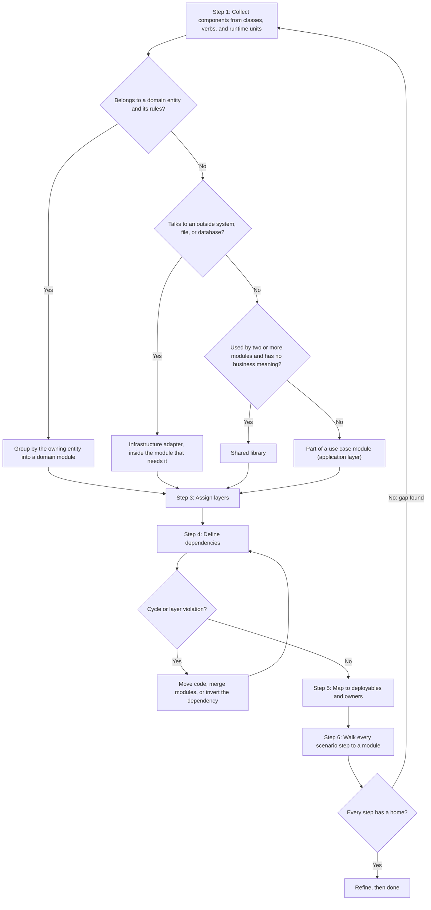
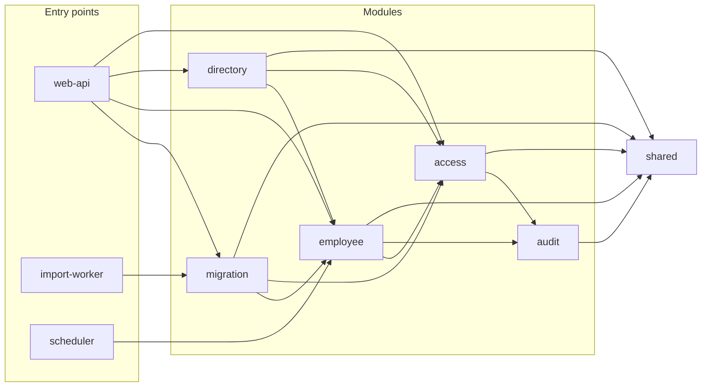

# Development View: Analysis Method

**Goal:** turn the logical model and the process view into a code structure: modules, layers, dependency rules, and ownership, so every developer knows where a new file goes.
**Input:** use case text, class diagram, components found in the logical view, runtime units from the process view, team structure.
**Output:** module list, layer assignment, module dependency diagram, folder layout, ownership.

The method is iterative. The first grouping is never right, because the dependencies between modules only show up once you walk the use cases through them.

> The logical view says **what exists**. The process view says **what runs**. The development view says **where the code lives and who may depend on whom**.

---

## Decision flow



---

## Step 1: Collect components

A **component** is any piece of code with one clear job. Gather them from three sources:

| Source                   | What to take                                                       |
| ------------------------ | ------------------------------------------------------------------ |
| Logical view classes     | Each entity needs somewhere to live (model, repository, rules)     |
| Use case verbs           | Parse, map, validate, import, report, search, mask, audit          |
| Process view units       | Web API, worker, scheduler: each needs an entry point              |

Also note the **user-facing screens** (UI wording dropped from the logical view comes back here) and the **external systems** touched.

Do not group anything yet.

### Example (from UC-01)

| Component          | Source                                              |
| ------------------ | --------------------------------------------------- |
| Migration UI       | Screen: Data Migration page                         |
| Migration API      | Process view: Web API, `uploadFile()` and others    |
| File Parser        | Verb "parses file headers", reads CSV and `.xlsx`   |
| Mapping Service    | Verb "maps", entity `ColumnMapping`                 |
| Validation Service | Verb "validates", entity `RowError`                 |
| Import Service     | Verb "creates records", entities `Employee` and children |
| Report Service     | Verb "displays summary", error CSV                  |
| Import Worker      | Process view: async job entry point                 |
| Employee repository | Entity `Employee`                                  |
| File storage client | External: stored uploads                           |

---

## Step 2: Group into modules

Ask these questions **in order** for each component. Stop at the first one that decides it.

| #   | Filter question                                                      | If yes                                          | If no    |
| --- | -------------------------------------------------------------------- | ----------------------------------------------- | -------- |
| 1   | Does it exist to serve one entity and its rules?                     | Put it in that **entity's module**              | Continue |
| 2   | Does it change for the same reason as a component already grouped?   | **Same module**                                 | Continue |
| 3   | Does it talk to an outside system (database, file store, email)?     | **Adapter** inside the module that uses it      | Continue |
| 4   | Is it used by two or more modules and free of business meaning?      | **Shared library**                              | Continue |
| 5   | Otherwise                                                            | Module of the **use case** it implements        |          |

**Rule of thumb (module boundary):** a module is a set of code that changes together and that one team can own. If a change to one use case forces edits in five modules, the boundaries are wrong. If two modules always change together, merge them.

### Example

| Component                              | Filter | Decision                                                       |
| -------------------------------------- | ------ | -------------------------------------------------------------- |
| Employee model, repository, rules      | 1      | **`employee` module** (owns `Employee`, `WorkHistory`, `SalaryEntry`, `Certification`) |
| File Parser, Mapping, Validation, Import, Report | 2 | **`migration` module.** All change when the import flow changes |
| Migration UI, Migration API, Import Worker | 2  | **`migration` module** (UI may live in a separate frontend package) |
| File storage client                    | 3      | **Adapter** in `migration` (only user), or shared if UC-03 uploads photos later |
| Role check, field masking              | 4      | **`access` module.** Used by UC-02, UC-05, UC-06, no domain data of its own |
| Audit log writer                       | 4      | **`audit` module.** Used by UC-03, UC-04, UC-06                |
| Search query builder                   | 5      | **`directory` module** (UC-05)                                 |
| Logging, config, date helpers          | 4      | **`shared` library**                                           |

---

## Step 3: Assign layers

Inside each module, separate code by what it depends on:

| Layer              | Contains                                         | May depend on                  |
| ------------------ | ------------------------------------------------ | ------------------------------ |
| **Presentation**   | Controllers, screens, request and response shapes | Application                    |
| **Application**    | Use case orchestration (services), job handlers  | Domain                         |
| **Domain**         | Entities, business rules, enumerations           | Nothing                        |
| **Infrastructure** | Database access, file storage, external clients  | Domain (implements its interfaces) |

**Rule:** dependencies point **inward** (toward domain). The domain layer never imports a framework, a database client, or a screen.

Place each component: `File Parser` is infrastructure (reads files) behind an interface the application layer uses; `Validation Service` rules are domain, orchestration is application; `Migration API` is presentation.

---

## Step 4: Define dependencies

For each pair of modules that interact, ask:

1. **Who calls whom?** This gives the direction.
2. **Through what?** Another module may use only its **public API** (a service interface or exported types), never its tables or internal classes.
3. **Is there a cycle?** If A depends on B and B on A, move the shared part out, merge them, or have one side publish an event instead.

| Pair                              | Decision                                                                 |
| --------------------------------- | ------------------------------------------------------------------------ |
| `migration` to `employee`         | **Depends on** `employee`'s public API to create records. Never writes its tables directly |
| `directory` to `employee`         | **Depends on** `employee`'s read API                                     |
| `employee`, `directory`, `migration` to `access` | **Depend on** `access` for permission and masking checks  |
| `employee`, `access` to `audit`   | **Depend on** `audit`'s write API                                        |
| `employee` to `migration`         | **Forbidden.** Employee must not know imports exist                      |
| everything to `shared`            | Allowed. `shared` depends on nothing                                     |

Draw the result and check there are **no cycles**.

### Resulting module diagram



---

## Step 5: Map to deployables, repos, and owners

Decide how modules become running code:

| Question                                                     | If yes                                         | If no                  |
| ------------------------------------------------------------ | ---------------------------------------------- | ---------------------- |
| Do two parts need independent deploys or different teams?    | Separate **repository or service**             | Same repository        |
| Do two runtime units share all modules?                      | **One codebase, several entry points** (API and worker) | Separate codebases |
| Does a module have a clear owner or team?                    | Record it (and a code owners file)             | Assign one             |

**Default for a small team and one product:** one repository, a **modular monolith** with several entry points (`web-api`, `import-worker`, `scheduler`) built from the same modules. Split into services only when a reason from the process or physical view demands it.

| Deliverable    | Built from                       | Runs as (process view)  |
| -------------- | -------------------------------- | ----------------------- |
| `web-api`      | All modules, HTTP entry          | Web API                 |
| `import-worker` | `migration`, `employee`, `access`, `shared` | Import Worker |
| `scheduler`    | `employee`, `shared`             | Scheduler               |
| `web-ui`       | Separate package (frontend)      | Browser                 |

---

## Step 6: Walk the scenario (the +1 check)

Take each use case step and point at the **module and layer** where its code lives. Anything you cannot place is a **gap**; go back to Step 1.

| Use case step    | Module and layer                          |
| ---------------- | ----------------------------------------- |
| 1 Upload         | `migration` presentation, storage adapter |
| 2 Parse and map  | `migration` application, parser adapter   |
| 3 Confirm        | `migration` application                   |
| 4 Validate       | `migration` application and domain rules  |
| 5 Create records | `migration` application calls `employee` API |
| 6 Summary        | `migration` application                   |
| E-1 / E-2        | `migration` domain (status), application  |

Then apply two further tests:

- **New file test:** pick a likely change ("add `Skill` to the employee profile"). Can you say which folder gets the files, and which other modules need no change?
- **Dependency test:** can a tool check your rules automatically? (For example, a lint rule that fails when `employee` imports from `migration`.) Rules nobody enforces get broken.

Then re-apply the Step 2 filters to anything debatable (for example, is `audit` big enough to be a module, or only a shared helper?) and write the reason next to the diagram.

### Resulting folder layout

```
src/
├── apps/
│   ├── web-api/            <- entry point: HTTP
│   ├── import-worker/      <- entry point: queue consumer
│   └── scheduler/          <- entry point: cron
├── modules/
│   ├── employee/
│   │   ├── presentation/   <- controllers
│   │   ├── application/    <- use case services (public API lives here)
│   │   ├── domain/         <- entities, rules
│   │   └── infrastructure/ <- repositories
│   ├── migration/          <- same four folders
│   ├── directory/
│   ├── access/
│   └── audit/
└── shared/                 <- config, logging, helpers (no business logic)
```

---

## Quick reference: when decisions happen

| When   | Decision                              | Based on                                           |
| ------ | ------------------------------------- | -------------------------------------------------- |
| Step 1 | Which components exist                | Classes, verbs, runtime units, screens             |
| Step 2 | Which module owns each component      | Entity ownership, reason to change, adapter, reuse |
| Step 3 | Layer inside the module               | What the code depends on                           |
| Step 4 | Allowed dependencies, no cycles       | Who calls whom, public API only                    |
| Step 5 | Deployables, repos, owners            | Process view units, team, deploy independence      |
| Step 6 | Is the structure complete?            | Every step has a home; new file test; enforced rules |

**Tip:** write the reason for each judgment call next to the diagram so your team can challenge it later.
