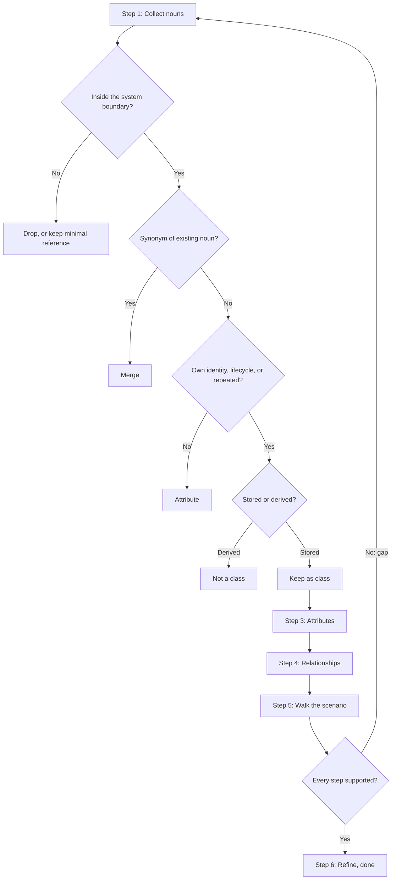

# Logical View Guide (4+1 Architecture)

A working guide for building the **Logical view** from use cases, with ready-to-copy templates for the **glossary**, **decision log**, and **traceability matrix**.

---

## 1. Purpose and scope

| Item                    | Description                                                                                                   |
| ----------------------- | ------------------------------------------------------------------------------------------------------------- |
| **View**                | Logical / Structural                                                                                          |
| **Question it answers** | What are the entities of the system, and how are they related?                                                |
| **Perspective**         | Analysts, designers                                                                                           |
| **Concern**             | Functionality                                                                                                 |
| **Input**               | Use cases (+1 Scenario view), business rules, domain knowledge                                                |
| **Output**              | Class diagrams, glossary, decision log, traceability matrix                                                   |
| **Not covered here**    | Interaction over time (Process view), module grouping (Implementation view), infrastructure (Deployment view) |

The logical view shows **who the entities are and how they connect**, not how they behave over time.

---

## 2. Workflow overview

| Phase | Activity                                                    | Where it is done        | Output                            |
| ----- | ----------------------------------------------------------- | ----------------------- | --------------------------------- |
| 1     | Steps 1 to 3: collect candidates, filter, assign attributes | Notes (Markdown tables) | Candidate table per use case      |
| 2     | Steps 4 to 6: relationships, walk the scenario, refine      | TypeORM entities        | Entities with relations           |
| 3     | Generate diagram from entities                              | Script or tool          | Mermaid or PlantUML class diagram |
| 4     | Run migration and test with sample data, then adjust        | Database and tests      | Validated model                   |
| 5     | Finalize glossary, decision log, traceability               | `docs/architecture/`    | Documentation set                 |

> **Rule:** write each decision into the decision log **at the moment you make it** (phases 1 and 2). Tidy it in phase 5, but do not wait until then to write it.

---

## 3. The six-step method

### Step 1: Collect candidates

Read the use case line by line. List **every noun**. Do not judge yet. Also note verbs, rules, and exception flows.

### Step 2: Filter candidates

Ask these questions in order. Stop at the first one that decides the candidate.

| #   | Question                                        | If yes                   | If no                                      |
| --- | ----------------------------------------------- | ------------------------ | ------------------------------------------ |
| 1   | Inside the system boundary?                     | Continue                 | Drop it, or keep a minimal reference class |
| 2   | Synonym of a noun already found?                | Merge into one concept   | Continue                                   |
| 3   | Own identity, lifecycle, or repeated instances? | Continue                 | Make it an **attribute**                   |
| 4   | Stored, or derived/generated from other data?   | Derived: **not a class** | **Keep as a class**                        |

**Rule of thumb:** if it can occur more than once per owner, has attributes of its own, or is referenced from several places, it is a class. Otherwise it is an attribute.

### Step 3: Assign attributes

| Source                    | Example                                             |
| ------------------------- | --------------------------------------------------- |
| Names in the text         | `fullName`, `dob`, `email`                          |
| Rules in the text         | "unique constraint on email" gives a unique `email` |
| State implied by the flow | Exception flows imply a `status` enumeration        |

### Step 4: Define relationships

For each pair of classes mentioned together, ask:

1. Who owns whom?
2. Can the child exist without the parent? **No** gives **composition**. **Yes** gives **association** or **dependency**.
3. How many on each side? (Take it from the wording.)

### Step 5: Walk the scenario (the +1 check)

For every use case step and exception flow, point at the class that supports it. Anything you cannot point at is a **gap**. Go back to Step 1.

### Step 6: Refine

Re-apply the Step 2 filters to anything debatable: **merge** duplicates, **split** overloaded entities, **simplify** needless classes.

### Decision flow



---

## 4. Working across many use cases

After the last use case, add a **consolidation** activity:

1. **Merge duplicates.** Different use cases may use different words for one concept. Pick one name and record it in the glossary.
2. **Extend, do not recreate.** Later use cases usually add attributes or relationships to existing entities.
3. **Split overloaded entities.** A class that collects unrelated attributes is probably two concepts.
4. **Resolve conflicts.** Raise contradictions with stakeholders and log them as decisions.
5. **Group into packages** once you pass roughly 10 to 15 classes. Keep one overview diagram plus one detailed diagram per package.
6. **Re-run the Step 5 check** for every use case against the merged model.

---

## 5. Recommended folder structure

```
docs/architecture/
├── logical-view-guide.md      <- this document
├── candidates/
│   ├── UC-01-candidates.md    <- Steps 1 to 3 notes per use case
│   └── UC-02-candidates.md
├── glossary.md
├── decision-log.md
├── traceability.md
└── diagrams/
    └── logical-overview.md    <- generated Mermaid
```

---

## 6. Template: candidate table (Steps 1 to 3, one per use case)

Copy into `candidates/UC-xx-candidates.md`.

```markdown
# UC-xx: <Use case name> - Candidates

## Step 1: Nouns found

<list every noun, verbs, rules, exception flows>

## Step 2: Filter results

| Candidate | Filter question                          | Decision                        | Reason         | Log ref |
| --------- | ---------------------------------------- | ------------------------------- | -------------- | ------- |
| <noun>    | <Boundary / Synonym / Identity / Stored> | Keep / Merge / Attribute / Drop | <short reason> | LD-xxx  |

## Step 3: Attributes

| Entity   | Attribute   | Type   | Constraint                 | Source (text, rule, or flow) |
| -------- | ----------- | ------ | -------------------------- | ---------------------------- |
| <Entity> | <attribute> | <type> | <unique / required / none> | <where it came from>         |

## Status or enumeration values

| Enumeration | Value   | Source (use case step or flow) |
| ----------- | ------- | ------------------------------ |
| <Name>      | <VALUE> | <step>                         |
```

---

## 7. Template: glossary

Copy into `glossary.md`. One entry per concept, alphabetical.

```markdown
# Glossary

| Term   | Definition                                     | Type                                            | Synonyms (do not use)                         | Used in      | Notes                                  |
| ------ | ---------------------------------------------- | ----------------------------------------------- | --------------------------------------------- | ------------ | -------------------------------------- |
| <Term> | <One-sentence definition in business language> | Entity / Attribute / Enumeration / Actor / Rule | <other names that were merged into this term> | UC-xx, UC-yy | <constraints, open questions, log ref> |
```

### Example

```markdown
| Term             | Definition                                                                                   | Type        | Synonyms (do not use)             | Used in | Notes                                                      |
| ---------------- | -------------------------------------------------------------------------------------------- | ----------- | --------------------------------- | ------- | ---------------------------------------------------------- |
| Column Mapping   | The link between a header in the uploaded file and a target field in the system              | Entity      | header map, field map             | UC-01   | Must be confirmed by HR Admin before validation            |
| Employee         | A person whose records are managed by the system                                             | Entity      | staff member, employee record     | UC-01   | `email` is unique. See LD-004                              |
| Migration Job    | One upload of a spreadsheet and its import attempt, from start to final status               | Entity      | spreadsheet, file, import, upload | UC-01   | Replaces four earlier terms. See LD-001                    |
| Migration Status | The current state of a Migration Job                                                         | Enumeration |                                   | UC-01   | UPLOADED, MAPPED, COMPLETED, COMPLETED_WITH_ERRORS, FAILED |
| Row Error        | A record of one invalid row found during validation, with its row number, field, and message | Entity      | error log entry                   | UC-01   | Only failed rows are stored. See LD-002                    |
```

**Rules for the glossary**

- One definition per term, written in business language, not code
- List merged synonyms so people know which words to stop using
- Update it whenever a decision merges or renames something

---

## 8. Template: decision log

Copy into `decision-log.md`. Newest entry at the bottom. Never delete an entry; mark it superseded.

### Entry template

```markdown
## LD-xxx: <Short title of the decision>

- **Date:** YYYY-MM-DD
- **Status:** Proposed / Accepted / Open / Superseded by LD-yyy
- **Source:** <use case and step, e.g. UC-01 step 4>
- **Method step:** <1 to 6, e.g. Step 2 (Filter: stored or derived?)>
- **Question:** <What was being decided?>
- **Decision:** <What was chosen?>
- **Reason:** <Why? Tie it to the use case or a rule.>
- **Alternatives considered:** <Other options and why they were rejected>
- **Consequences:** <What this changes or restricts>
- **Revisit if:** <The condition that would justify reversing this>
```

### What to log

Log a decision if someone could reasonably ask "why not the other way?":

- A candidate was dropped, merged, or turned into an attribute
- Composition versus association or dependency
- Something is derived instead of stored (or the reverse)
- A business rule was interpreted or assumed
- Two use cases conflicted and one was chosen

Do not log obvious choices such as "Employee has a name".

### Example entries

```markdown
## LD-001: Fold MigrationSummary into MigrationJob

- **Date:** 2026-10-22
- **Status:** Accepted
- **Source:** UC-01 step 6
- **Method step:** Step 6 (Refine)
- **Question:** Should the migration summary be its own entity?
- **Decision:** No. Store `totalRows`, `importedCount`, `failedCount` on `MigrationJob`.
- **Reason:** The numbers belong to exactly one job, and `failedCount` equals the number of `RowError` rows.
- **Alternatives considered:** Separate `MigrationSummary` entity. Rejected: adds a join and no new information.
- **Consequences:** One fewer table. Summary is read from the job.
- **Revisit if:** Reports need their own history or versions.

## LD-002: Do not model "row" as an entity

- **Date:** 2026-10-22
- **Status:** Accepted
- **Source:** UC-01 step 4
- **Method step:** Step 2 (Filter: stored or derived?)
- **Question:** Should every uploaded row be stored?
- **Decision:** No. Only failed rows are stored, as `RowError`.
- **Reason:** Rows exist in memory during validation. Storing all of them would duplicate the uploaded file.
- **Alternatives considered:** Store all rows in a staging table. Rejected for this scope.
- **Consequences:** Validation cannot be re-run without the original file.
- **Revisit if:** Users need to re-run validation without re-uploading.

## LD-003: MigrationJob does not own Employee

- **Date:** 2026-10-22
- **Status:** Accepted
- **Source:** UC-01 step 5
- **Method step:** Step 4 (Relationships)
- **Question:** Is the link between a job and the employees it creates composition?
- **Decision:** No relation in the schema. The job "creates" employees, but they are independent afterward.
- **Reason:** Deleting an old job record must not delete employees.
- **Alternatives considered:** Composition with cascade delete. Rejected: dangerous.
- **Consequences:** Tracing which job created an employee needs an optional `createdByJobId` column.
- **Revisit if:** Audit requires tracing employees back to their import.

## LD-004: Duplicate email handling

- **Date:** 2026-10-22
- **Status:** Open (waiting for business owner)
- **Source:** UC-01 step 4
- **Method step:** Step 3 (Rules)
- **Question:** Is a duplicate email a validation failure or an update to the existing employee?
- **Decision:** Pending. Current assumption: validation failure, as the use case says "unique constraints".
- **Reason:** Matches the wording of the use case.
- **Alternatives considered:** Update the existing record.
- **Consequences if wrong:** Changes the Validation Service and adds an update path to the Import Service.
- **Revisit if:** The business owner answers.
```

### Tips

| Rule                                       | Why                                                         |
| ------------------------------------------ | ----------------------------------------------------------- |
| Record the **reason**, not just the result | The result is visible in code; the reason is what gets lost |
| Link to a **use case step**                | Tells you what to re-check if the use case changes          |
| Always add **"Revisit if"**                | Shows the decision is conditional                           |
| Allow **Open** status                      | Unanswered questions are the most valuable entries          |
| Mark **Superseded** instead of deleting    | Keeps the history                                           |
| Point to the entry from code               | e.g. `// No relation to Employee on purpose. See LD-003.`   |

After roughly 20 entries, consider one file per decision (`decisions/LD-001-fold-summary-into-job.md`).

---

## 9. Template: traceability

Copy into `traceability.md`. It has three tables, each answering a different question.

### 9.1 Entity to use case matrix

Which use cases rely on which entities? Use it to spot unused entities and to see the impact of changing one.

```markdown
| Entity   | UC-01 | UC-02 | UC-03 | Notes                                             |
| -------- | ----- | ----- | ----- | ------------------------------------------------- |
| <Entity> | C     | R     |       | <C = created, R = read, U = updated, D = deleted> |
```

Example:

```markdown
| Entity        | UC-01 | UC-02 | UC-03 | Notes             |
| ------------- | ----- | ----- | ----- | ----------------- |
| Employee      | C     | R, U  | R     | Core entity       |
| WorkHistory   | C     | R     |       | Owned by Employee |
| SalaryEntry   | C     | R     |       | Owned by Employee |
| Certification | C     | R     |       | Owned by Employee |
| MigrationJob  | C, U  |       |       |                   |
| ColumnMapping | C, U  |       |       |                   |
| RowError      | C     |       |       |                   |
```

**How to read it**

- An **empty row** means an entity no use case needs. Remove it or find the missing use case.
- An **empty column** means a use case that touches no entity. The model has a gap.

### 9.2 Use case step to model matrix (the +1 check)

Proves that every step and exception flow is supported by the model.

```markdown
## UC-xx: <name>

| Step or flow | Supported by (entity / attribute) | Implementation component | Process view message | Status   |
| ------------ | --------------------------------- | ------------------------ | -------------------- | -------- |
| <step>       | <entity.attribute>                | <component>              | <message>            | OK / Gap |
```

Example:

```markdown
## UC-01: Import Employee Spreadsheet

| Step or flow        | Supported by                           | Implementation component     | Process view message      | Status |
| ------------------- | -------------------------------------- | ---------------------------- | ------------------------- | ------ |
| 1 Upload file       | MigrationJob                           | Migration UI, Migration API  | uploadFile()              | OK     |
| 2 Parse and map     | ColumnMapping                          | File Parser, Mapping Service | parse(), suggestMapping() | OK     |
| 3 Confirm mapping   | ColumnMapping.confirmed                | Migration UI                 | confirmMapping()          | OK     |
| 4 Validate          | RowError, Employee.email (unique)      | Validation Service           | validate()                | OK     |
| 5 Create records    | Employee and children                  | Import Service               | createRecords()           | OK     |
| 6 Summary           | MigrationJob counts                    | Report Service               | buildSummary()            | OK     |
| E-1 Malformed file  | MigrationJob.status = FAILED           | File Parser                  | alt E-1                   | OK     |
| E-2 Partial failure | RowError, status COMPLETED_WITH_ERRORS | Validation, Report Service   | alt E-2                   | OK     |
```

Leave the last two columns empty until you reach those views. This one table then links all four views to the use case.

### 9.3 Decision to use case index

Which decisions affect which use cases? Use it when a use case changes.

```markdown
| Decision | Title   | Status          | Use cases | Entities affected |
| -------- | ------- | --------------- | --------- | ----------------- |
| LD-xxx   | <title> | Accepted / Open | UC-xx     | <Entity>          |
```

Example:

```markdown
| Decision | Title                                   | Status   | Use cases | Entities affected      |
| -------- | --------------------------------------- | -------- | --------- | ---------------------- |
| LD-001   | Fold MigrationSummary into MigrationJob | Accepted | UC-01     | MigrationJob           |
| LD-002   | Do not model "row" as an entity         | Accepted | UC-01     | RowError               |
| LD-003   | MigrationJob does not own Employee      | Accepted | UC-01     | MigrationJob, Employee |
| LD-004   | Duplicate email handling                | Open     | UC-01     | Employee               |
```

---

## 10. Completion checklist

**Per use case**

- [ ] Nouns collected (Step 1)
- [ ] Every candidate has a decision and reason (Step 2)
- [ ] Attributes and enumerations assigned (Step 3)
- [ ] Relationships and multiplicities defined (Step 4)
- [ ] Every step and exception flow has a Supported-by entry (Step 5)
- [ ] Judgment calls logged

**Across all use cases**

- [ ] Duplicates merged, names agreed
- [ ] Overloaded entities split
- [ ] Conflicts resolved or logged as Open
- [ ] Packages defined if more than about 10 to 15 classes
- [ ] Step 5 re-run for every use case against the merged model

**Delivery**

- [ ] Diagram generated from entities
- [ ] Migration run and tested with sample data
- [ ] Glossary complete, with merged synonyms listed
- [ ] Decision log has no undated or reasonless entries
- [ ] Traceability tables have no empty rows or columns
- [ ] Open decisions have an owner

---

## 11. Common mistakes

| Mistake                                        | Effect                           | Fix                                      |
| ---------------------------------------------- | -------------------------------- | ---------------------------------------- |
| Starting with database tables                  | Models storage, not the domain   | Do Steps 1 to 3 as notes first           |
| Keeping UI words as classes ("page", "button") | Pollutes the domain model        | Apply the boundary filter                |
| One class per spreadsheet column group         | Misses real concepts             | Apply the identity and repetition filter |
| Skipping exception flows                       | Misses classes and status values | Read E-flows in Step 3                   |
| Writing the log at the end                     | Reasons are forgotten            | Log each decision when made              |
| Treating the model as final                    | Later use cases break it         | Re-run Step 5 after every change         |
