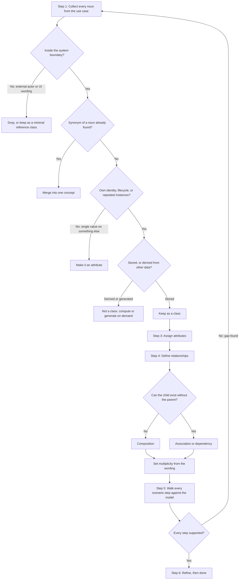
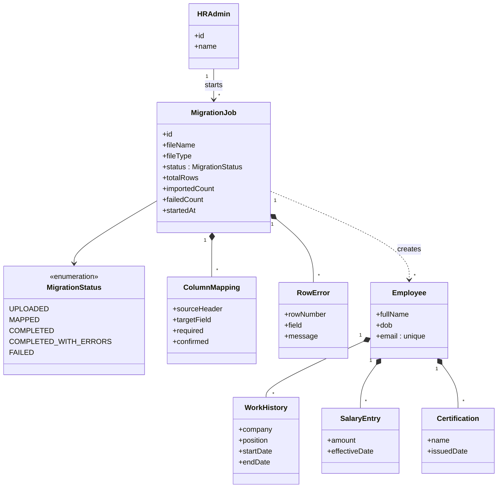

# Logical View: Analysis Method

**Goal:** turn a use case (the +1 Scenario view) into a class diagram (structural model).
**Input:** use case text, business rules, domain knowledge.
**Output:** class diagram of entities, attributes, and relationships.

The method is iterative. The first model is never right, because exception flows usually reveal classes the main scenario hides.

---

## Decision flow

---

## Step 1: Collect candidates

Read the use case line by line and list **every noun**. Do not judge yet.

Also note verbs (they become components later), rules, and exception flows.

---

## Step 2: Filter candidates

Ask these questions **in order** for each noun. Stop at the first one that decides it.

| #   | Filter question                                 | If yes                   | If no                                                                       |
| --- | ----------------------------------------------- | ------------------------ | --------------------------------------------------------------------------- |
| 1   | Inside the system boundary?                     | Continue                 | Drop it, or keep a minimal reference class (e.g. an actor needed for audit) |
| 2   | Synonym of a noun already found?                | Merge into one concept   | Continue                                                                    |
| 3   | Own identity, lifecycle, or repeated instances? | Continue                 | Make it an **attribute**                                                    |
| 4   | Stored, or derived/generated from other data?   | Derived: **not a class** | **Keep as a class**                                                         |

**Rule of thumb (class vs attribute):** if it can occur more than once per owner, has attributes of its own, or is referenced from several places, it is a class. Otherwise it is an attribute.

### Example (UC-01: Import Employee Spreadsheet)

| Candidate                                 | Filter                 | Decision                                                            |
| ----------------------------------------- | ---------------------- | ------------------------------------------------------------------- |
| HR Admin                                  | Inside the system?     | **Keep, minimal.** External actor, but a job needs "who started it" |
| Data Migration page                       | Inside the system?     | **Drop.** UI wording, belongs to the implementation view            |
| spreadsheet, file, CSV, `.xlsx`           | Synonyms?              | **Merge** into `MigrationJob` (`fileName`, `fileType`)              |
| column mapping                            | Own identity or state? | **Keep** as `ColumnMapping` (has a "confirmed" state)               |
| row                                       | Stored?                | **Drop.** Exists only in memory; failed rows persist as `RowError`  |
| employee record                           | Own identity?          | **Keep** as `Employee`                                              |
| Full Name, DOB, email                     | Own lifecycle?         | **Attributes** of `Employee`                                        |
| work history, salary entry, certification | Repeated instances?    | **Keep** as classes ("Salary _History_" means many per employee)    |
| error log                                 | Own data?              | **Keep** as `RowError` (row number, field, message)                 |
| migration summary report                  | Stored or derived?     | **Debatable.** Counts can be derived, decide in Step 6              |
| Error Summary CSV                         | Stored or derived?     | **Drop.** Generated file, not a domain entity                       |

---

## Step 3: Assign attributes

Attributes come from three sources:

| Source                    | Example                                                                                                         |
| ------------------------- | --------------------------------------------------------------------------------------------------------------- |
| Names in the text         | `fullName`, `dob`, `email`                                                                                      |
| Rules in the text         | "unique constraint on email" means `Employee.email` is unique; "required fields" means `ColumnMapping.required` |
| State implied by the flow | Exception flows imply a `status` on the job (see below)                                                         |

### Example: status values from the flows

| Source in the use case | Status                  |
| ---------------------- | ----------------------- |
| Step 1                 | `UPLOADED`              |
| Step 3                 | `MAPPED`                |
| Step 6, all rows valid | `COMPLETED`             |
| E-2                    | `COMPLETED_WITH_ERRORS` |
| E-1                    | `FAILED`                |

---

## Step 4: Define relationships

For every pair of classes that appear in the same sentence, ask:

1. **Who owns whom?** This gives the direction.
2. **Can the child exist without the parent?** No means **composition**; yes means **association** or **dependency**.
3. **How many?** Multiplicity comes from the wording ("50 records" means many; "a report" means one).

| Pair                                                           | Decision                                                            |
| -------------------------------------------------------------- | ------------------------------------------------------------------- |
| `Employee` and `WorkHistory` / `SalaryEntry` / `Certification` | **Composition.** A salary entry has no meaning without its employee |
| `MigrationJob` and `ColumnMapping` / `RowError`                | **Composition.** Meaningless once the job is gone                   |
| `MigrationJob` and `Employee`                                  | **Dependency ("creates").** Employees must outlive the job record   |
| `HRAdmin` and `MigrationJob`                                   | **Association**, one admin to many jobs                             |

---

## Step 5: Walk the scenario (the +1 check)

Take each use case step and point at the class that supports it. Anything you cannot point at is a **gap**, so go back to Step 1.

| Use case step    | Supported by                                   |
| ---------------- | ---------------------------------------------- |
| 1 Upload         | `MigrationJob`                                 |
| 2 Map headers    | `ColumnMapping`                                |
| 3 Confirm        | `ColumnMapping.confirmed`                      |
| 4 Validate       | `RowError`, unique `Employee.email`            |
| 5 Create records | `Employee` and its three child classes         |
| 6 Summary        | counts on `MigrationJob`                       |
| E-1              | `MigrationJob.status = FAILED`                 |
| E-2              | `RowError` plus status `COMPLETED_WITH_ERRORS` |

---

## Step 6: Refine

Re-apply the Step 2 filters to anything left debatable.

**Example:** `MigrationSummary` has `totalRows`, `importedCount`, `failedCount`. These are three numbers belonging to one job, and `failedCount` equals the number of `RowError` rows. Fold them into `MigrationJob`. Keep a separate class only if reports need their own history or versions.

### Resulting class diagram

---

## Quick reference: when decisions happen

| When   | Decision                                 | Based on                                        |
| ------ | ---------------------------------------- | ----------------------------------------------- |
| Step 1 | Which nouns are candidates               | Underlining the text                            |
| Step 2 | Class, attribute, merge, or drop         | Boundary, synonyms, identity, stored vs derived |
| Step 3 | Attributes and status values             | Names, rules, exception flows                   |
| Step 4 | Composition vs association, multiplicity | "Can the child outlive the parent?", wording    |
| Step 5 | Is the model complete?                   | Every use case step must point at a class       |
| Step 6 | Merge, split, or simplify                | Re-run the Step 2 filters                       |

**Tip:** write the reason for each judgment call next to the diagram so your team can challenge it later.
