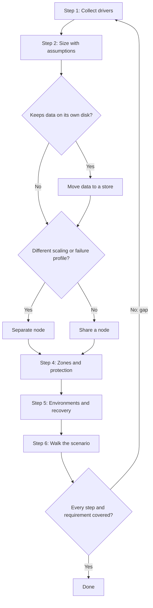

# Physical View Guide (4+1 Architecture)

A working guide for building the **Physical view** from the runtime units and the non-functional requirements, with ready-to-copy templates for the **requirements register**, **node catalog**, **environment matrix**, **data protection register**, **decision log**, and **traceability matrix**.

---

## 1. Purpose and scope

| Item                    | Description                                                                                                    |
| ----------------------- | -------------------------------------------------------------------------------------------------------------- |
| **View**                | Physical / Deployment                                                                                          |
| **Question it answers** | Which node runs what, how do nodes connect, and what keeps the system safe, available, and recoverable?        |
| **Perspective**         | System engineers, operations, security                                                                         |
| **Concern**             | Topology, delivery, installation, availability, security                                                       |
| **Input**               | Runtime unit catalog (Process view), deliverables (Development view), non-functional requirements, constraints |
| **Output**              | Deployment diagram, node catalog, environment matrix, data protection register, decision log, traceability     |
| **Not covered here**    | Entities (Logical view), runtime messages (Process view), code structure (Development view)                    |

The physical view shows **where the system runs and what it runs on**, not how the code is organized.

---

## 2. Workflow overview

| Phase | Activity                                                       | Where it is done          | Output                              |
| ----- | -------------------------------------------------------------- | ------------------------- | ----------------------------------- |
| 1     | Steps 1 and 2: collect drivers, size the load                  | Notes (Markdown tables)   | Requirements register               |
| 2     | Step 3: map runtime units to nodes                             | Mermaid deployment diagram | Node catalog, diagram              |
| 3     | Step 4: zones, paths, data protection                          | Notes                     | Data protection register            |
| 4     | Step 5: environments, delivery, monitoring, recovery           | Notes, then pipeline      | Environment matrix, targets         |
| 5     | Step 6: walk the scenario and every requirement                | Traceability table        | Steps and requirements linked to nodes |
| 6     | Prove it: stop a node, restore a backup, scan the network      | Staging environment       | Verified design                     |
| 7     | Finalize registers, decision log, traceability                 | `docs/architecture/`      | Documentation set                   |

> **Rule:** write each decision into the decision log **at the moment you make it**. Tidy it in phase 7, but do not wait until then to write it.

---

## 3. The six-step method

### Step 1: Collect physical drivers

List users, data volume, sensitive data, availability and performance words, integrations, and constraints. Write "unknown" where a number is missing and ask the business owner.

### Step 2: Size the load

Turn each driver into a number. Mark each one **Confirmed**, **Assumption**, or **Open**. A small internal system needs safety more than scale.

### Step 3: Map runtime units to nodes

Ask in order. Stop at the first question that decides it.

| #   | Question                                           | If yes                                | If no    |
| --- | -------------------------------------------------- | ------------------------------------- | -------- |
| 1   | Keeps important data on its own disk?              | **Move the data out**, then continue  | Continue |
| 2   | Is it a store (database, queue, file storage)?     | **Managed service** or dedicated node | Continue |
| 3   | Scales or fails differently from another unit?     | **Separate node**                     | Continue |
| 4   | Otherwise                                          | **Share a node**                      |          |

**Rule of thumb:** every compute node must be replaceable at any moment without losing data.

### Step 4: Zones, paths, and data protection

Public, app, and data zones. Only the load balancer faces the internet. For each connection record protocol and protection. For each kind of sensitive data record storage, encryption, access, and retention.

### Step 5: Environments, delivery, monitoring, and recovery

Environments, configuration and secrets, pipeline and rollback, health checks and alerts, backups, and the RPO and RTO targets.

### Step 6: Walk the scenario (the +1 check)

For every use case step and exception flow: where does it run, and what if that node dies? For every non-functional requirement: which mechanism, and how is it verified? Anything missing is a **gap**. Go back to Step 1.

### Decision flow



---

## 4. Working across many use cases

After the last use case, add a **consolidation** activity:

1. **Merge nodes.** Several runtime units often fit on one node at this scale. Fewer nodes means less to run.
2. **Collect the strictest requirement.** The use case with the most sensitive data (salary in UC-02, UC-04) sets the protection level for the whole data zone.
3. **Check shared resources.** Database connections, storage quota, and queue limits are shared by all use cases.
4. **Re-check sizing** with all use cases running together, not one at a time (for example an import running while HR is editing).
5. **Reconcile with the other views.** Every runtime unit in the Process view has a node. Every deliverable in the Development view is deployed somewhere.
6. **Re-run the Step 6 check** for every use case against the merged model.

---

## 5. Recommended folder structure

```
docs/architecture/
├── logical-view-guide.md
├── process-view-guide.md
├── development-view-guide.md
├── physical-view-guide.md          <- this document
├── requirements-register.md        <- Steps 1 and 2
├── node-catalog.md
├── environment-matrix.md
├── data-protection-register.md
├── physical-decision-log.md
├── traceability.md                 <- shared with the other views
└── diagrams/
    └── deployment.md               <- Mermaid
```

Infrastructure as code (Terraform, Docker Compose, Helm, or your platform's equivalent) lives in the repository next to the code. The diagram describes it; the code is the source of truth.

---

## 6. Template: requirements register (Steps 1 and 2)

Copy into `requirements-register.md`.

```markdown
# Requirements register

| ID     | Category                                                  | Requirement                  | Number / target | Source         | Status                          | Log ref |
| ------ | --------------------------------------------------------- | ---------------------------- | --------------- | -------------- | ------------------------------- | ------- |
| NFR-xx | Users / Data / Security / Availability / Performance / Constraint | <what must be true>   | <number or rule> | <who said it> | Confirmed / Assumption / Open   | PH-xxx  |
```

### Example

```markdown
| ID     | Category     | Requirement                                   | Number / target       | Source          | Status      | Log ref |
| ------ | ------------ | --------------------------------------------- | --------------------- | --------------- | ----------- | ------- |
| NFR-01 | Users        | Employees managed                             | 500                   | HR              | Confirmed   |         |
| NFR-02 | Users        | Concurrent users                              | 30                    | Estimate        | Assumption  | PH-001  |
| NFR-03 | Data         | Largest import                                | 5 MB, 2,000 rows      | Current sheet   | Assumption  | PH-001  |
| NFR-04 | Security     | Salary visible to BOD and HR Admin only       | Field-level masking   | UC-02, UC-06    | Confirmed   |         |
| NFR-05 | Security     | Personal data stays in the company's region   | Region to be named    | Legal           | Open        | PH-003  |
| NFR-06 | Availability | Available during working hours                | 99%                   | Business owner  | Open        | PH-002  |
| NFR-07 | Recovery     | Maximum data loss (RPO) / downtime (RTO)      | 24 h / 4 h            | Estimate        | Assumption  | PH-002  |
| NFR-08 | Performance  | Directory search "in real time"               | Under 2 seconds       | UC-05           | Assumption  |         |
```

---

## 7. Template: node catalog

Copy into `node-catalog.md`. One row per node.

```markdown
# Node catalog

| Node   | Type                                   | Hosts (runtime units) | Instances | Size    | Zone           | State held | Failure behavior | Log ref |
| ------ | -------------------------------------- | --------------------- | --------- | ------- | -------------- | ---------- | ---------------- | ------- |
| <name> | Container / VM / Managed store / Static host | <units>        | <number>  | <small / medium / ...> | Public / App / Data | <none / data> | <what happens when it dies> | PH-xxx |
```

### Example

```markdown
| Node            | Type            | Hosts                | Instances | Size   | Zone   | State held         | Failure behavior                           | Log ref |
| --------------- | --------------- | -------------------- | --------- | ------ | ------ | ------------------ | ------------------------------------------ | ------- |
| web-ui          | Static host     | Web UI               | n/a       | n/a    | Public | None               | CDN serves cached copy                     |         |
| load-balancer   | Managed         | Routing, TLS         | n/a       | n/a    | Public | None               | Provider redundancy                        |         |
| api             | Container       | Web API              | 2         | Small  | App    | None               | Other instance serves, platform restarts   | PH-004  |
| worker          | Container       | Import Worker        | 1         | Medium | App    | None               | Job retried after restart (idempotent)     | PH-004  |
| scheduler       | Container       | Scheduler            | 1         | Small  | App    | None               | Missed run caught by the next run          |         |
| database        | Managed store   | Database             | 1 + backup | Small | Data   | All records        | Restore from backup, within RTO            | PH-002  |
| queue           | Managed store   | Job Queue            | n/a       | n/a    | Data   | Pending jobs       | Persisted, survives restart                |         |
| object-storage  | Managed store   | File Storage         | n/a       | n/a    | Data   | Uploads, error CSV | Versioned bucket                           |         |
```

**Rules for the catalog**

- Every runtime unit in the Process view appears on at least one node
- Every compute node says **State held: none**, or the design has a problem
- Every node says what happens when it fails

---

## 8. Template: environment matrix

Copy into `environment-matrix.md`.

```markdown
# Environment matrix

| Environment | Purpose              | Same shape as production? | Data                       | Who can deploy       | Who can access        | Notes |
| ----------- | -------------------- | ------------------------- | -------------------------- | -------------------- | --------------------- | ----- |
| <name>      | <what it is for>     | Yes / Smaller / No        | Fake / Masked copy / Real  | <people or pipeline> | <roles>               | <refs> |
```

### Example

```markdown
| Environment | Purpose                      | Same shape as production? | Data                | Who can deploy        | Who can access     | Notes                              |
| ----------- | ---------------------------- | ------------------------- | ------------------- | --------------------- | ------------------ | ---------------------------------- |
| dev         | Daily development            | Smaller                   | Fake                | Any developer         | Developers         | Local containers are enough        |
| staging     | Release check, restore drill | Yes                       | Masked copy         | Pipeline on merge     | Developers, QA     | Failure tests run here             |
| production  | Real use                     | n/a                       | Real                | Pipeline after approval | Operations only  | Backups on. Rollback documented    |
```

---

## 9. Template: data protection register

Copy into `data-protection-register.md`. One row per kind of sensitive data.

```markdown
| Data         | Classification                    | Stored in | Encrypted at rest | In transit | Who can read       | Retention | Log ref |
| ------------ | --------------------------------- | --------- | ----------------- | ---------- | ------------------ | --------- | ------- |
| <data kind>  | Public / Internal / Confidential / Restricted | <node> | Yes / No     | <protocol> | <roles>            | <period>  | PH-xxx  |
```

### Example

```markdown
| Data                  | Classification | Stored in      | Encrypted at rest | In transit | Who can read                    | Retention                | Log ref |
| --------------------- | -------------- | -------------- | ----------------- | ---------- | ------------------------------- | ------------------------ | ------- |
| Salary history        | Restricted     | database       | Yes               | TLS        | BOD, HR Admin, the employee (own) | Employment plus legal period | PH-003 |
| National ID           | Restricted     | database       | Yes               | TLS        | HR Admin                        | Employment plus legal period | PH-003 |
| Personal details      | Confidential   | database       | Yes               | TLS        | HR Admin, BOD, Line Manager     | Employment plus legal period |         |
| Uploaded spreadsheets | Restricted     | object-storage | Yes               | TLS        | Import Worker only              | Delete after import (30 days max) | PH-005 |
| Error summary CSV     | Confidential   | object-storage | Yes               | TLS        | HR Admin who ran the import     | 30 days                  | PH-005  |
| Audit log             | Confidential   | database       | Yes               | TLS        | System Administrator            | Per policy               |         |
```

> The uploaded spreadsheet is the easiest place for a salary leak: it holds everything the database holds, in one file. Decide its retention on purpose.

---

## 10. Template: decision log

Copy into `physical-decision-log.md`. Newest entry at the bottom. Never delete an entry; mark it superseded.

### Entry template

```markdown
## PH-xxx: <Short title of the decision>

- **Date:** YYYY-MM-DD
- **Status:** Proposed / Accepted / Open / Superseded by PH-yyy
- **Source:** <use case step, requirement id, or earlier decision>
- **Method step:** <1 to 6, e.g. Step 3 (Map: separate node?)>
- **Question:** <What was being decided?>
- **Decision:** <What was chosen?>
- **Reason:** <Why? Tie it to a number, a requirement, or a constraint.>
- **Alternatives considered:** <Other options and why they were rejected>
- **Consequences:** <What this changes or restricts, including cost>
- **Revisit if:** <The condition that would justify reversing this>
```

### What to log

Log a decision if someone could reasonably ask "why not the other way?":

- A sizing number was assumed, and the design depends on it
- Managed service versus self-run, one node versus two
- A zone or network rule
- A recovery target (RPO and RTO) or backup schedule
- Where sensitive data is stored, for how long, and who may read it
- A constraint (provider, region, budget) that forced the design

### Example entries

```markdown
## PH-001: Size for 30 concurrent users and 2,000-row imports

- **Date:** 2026-11-22
- **Status:** Accepted
- **Source:** NFR-02, NFR-03
- **Method step:** Step 2 (Size)
- **Question:** How big must the system be?
- **Decision:** Two small API instances and one medium worker. No autoscaling.
- **Reason:** 500 employees and a few dozen users do not need more. Two API instances give resilience, not capacity.
- **Alternatives considered:** Single instance. Rejected: a restart means downtime. Autoscaling. Rejected: adds cost and complexity with no need.
- **Consequences:** Sizing is an assumption. Load test once with a 2,000-row import running during normal use.
- **Revisit if:** Users exceed 100, or an import exceeds 20,000 rows.

## PH-002: Managed database with daily backup, RPO 24 hours, RTO 4 hours

- **Date:** 2026-11-22
- **Status:** Open (waiting for business owner)
- **Source:** NFR-06, NFR-07
- **Method step:** Step 5 (Recovery)
- **Question:** How much data may we lose, and how long may HR be without the system?
- **Decision:** Pending. Current assumption: RPO 24 hours, RTO 4 hours, daily backup kept 30 days, restore drill each quarter.
- **Reason:** HR data changes slowly. A day of lost edits can be re-entered.
- **Alternatives considered:** Point-in-time recovery (RPO of minutes). Costs more; justified only if edits are frequent.
- **Consequences if wrong:** Changes backup type, database tier, and monthly cost.
- **Revisit if:** The business owner answers, or after the first restore drill.

## PH-003: Data region and encryption for salary and national ID

- **Date:** 2026-11-22
- **Status:** Open (waiting for legal)
- **Source:** NFR-04, NFR-05
- **Method step:** Step 4 (Data protection)
- **Question:** In which region must personal data live, and what encryption is required?
- **Decision:** Pending. Current assumption: one region in the company's country, encryption at rest and in transit, credentials in a secret store.
- **Reason:** Salary and national ID are the most sensitive data in the system.
- **Alternatives considered:** Any region. Rejected until legal confirms.
- **Consequences if wrong:** May change the cloud region and the choice of managed services.
- **Revisit if:** Legal answers.

## PH-004: API and worker are separate containers

- **Date:** 2026-11-22
- **Status:** Accepted
- **Source:** PD-002, DV-001
- **Method step:** Step 3 (Map: separate node?)
- **Question:** Do the Web API and the Import Worker share a container?
- **Decision:** No. Same image, different start command.
- **Reason:** An import uses CPU and memory in bursts and must not slow down HR users browsing profiles.
- **Alternatives considered:** One container running both. Rejected: one import could starve the API.
- **Consequences:** Two deployment targets, built from one codebase.
- **Revisit if:** Imports are so rare that the extra container is wasted cost.

## PH-005: Delete uploaded spreadsheets after 30 days

- **Date:** 2026-11-22
- **Status:** Accepted
- **Source:** UC-01 step 1, LD-002
- **Method step:** Step 4 (Data protection)
- **Question:** How long do we keep the original file?
- **Decision:** 30 days, then delete automatically.
- **Reason:** The file holds salary data. The Logical view does not store all rows, so the file is needed briefly for retries and support.
- **Alternatives considered:** Delete right after import. Rejected: blocks re-run after a failed job. Keep forever. Rejected: needless exposure.
- **Consequences:** Bucket needs a lifecycle rule.
- **Revisit if:** Retention policy from legal says otherwise.
```

### Tips

| Rule                                         | Why                                                           |
| -------------------------------------------- | ------------------------------------------------------------- |
| Record the **number** and mark it an assumption | A wrong number found later should be easy to trace and fix |
| Link to a **requirement or process decision** | Shows which constraint forced the design                     |
| Always add **"Revisit if"**                  | Shows the decision is conditional                             |
| Allow **Open** status                        | Unanswered questions (legal, availability) are the most valuable entries |
| Mark **Superseded** instead of deleting      | Keeps the history                                             |
| Note the **cost** in Consequences            | Infrastructure choices are also budget choices                |

---

## 11. Template: traceability

Add these to `traceability.md` (shared with the other views).

### 11.1 Runtime unit to node matrix

Every runtime unit from the Process view must have a node, and every node must host something.

```markdown
| Runtime unit | Node | Instances | Why this node | Log ref |
| ------------ | ---- | --------- | ------------- | ------- |
```

Example:

```markdown
| Runtime unit  | Node           | Instances | Why this node                                  | Log ref |
| ------------- | -------------- | --------- | ---------------------------------------------- | ------- |
| Web API       | api            | 2         | Resilience: one restart must not cause downtime | PH-001  |
| Import Worker | worker         | 1         | Bursty CPU, kept apart from the API            | PH-004  |
| Scheduler     | scheduler      | 1         | Must be a single instance                      |         |
| Database      | database       | 1 + backup | Managed, automated backups                    | PH-002  |
| File Storage  | object-storage | n/a       | Containers have no durable local disk          | PH-005  |
```

### 11.2 Use case step to node matrix (the +1 check)

Completes the matrix started in the other three views.

```markdown
## UC-xx: <name>

| Step or flow | Supported by (entity) | Module (Development) | Message (Process) | Node (Physical) | If the node fails | Status   |
| ------------ | --------------------- | -------------------- | ----------------- | --------------- | ----------------- | -------- |
| <step>       | <entity>              | <module>             | <message>         | <node>          | <answer>          | OK / Gap |
```

Example:

```markdown
## UC-01: Import Employee Spreadsheet

| Step or flow        | Supported by              | Module               | Message              | Node                | If the node fails                    | Status |
| ------------------- | ------------------------- | -------------------- | -------------------- | ------------------- | ------------------------------------ | ------ |
| 1 Upload file       | MigrationJob              | migration            | uploadFile()         | api, object-storage | Retry on other instance              | OK     |
| 2 Parse and map     | ColumnMapping             | migration            | suggestMapping()     | api, database       | Managed database failover            | OK     |
| 3 Confirm mapping   | ColumnMapping.confirmed   | migration            | confirmMapping()     | api, database       | Repeat call ignored (status guard)   | OK     |
| 4 Validate          | RowError                  | migration            | importJob() validate | worker, database    | Job retried by new worker            | OK     |
| 5 Create records    | Employee and children     | migration, employee  | importJob() insert   | worker, database    | Job retried, idempotent              | OK     |
| 6 Summary           | MigrationJob counts       | migration            | getJobStatus()       | api, database       | UI keeps polling                     | OK     |
| E-1 Malformed file  | MigrationJob.status       | migration            | alt E-1              | api                 | Other instance                       | OK     |
| E-2 Partial failure | RowError                  | migration            | alt E-2              | worker, object-storage | Error CSV regenerated from RowError | OK   |
```

This one table now links **all four views** to the use case.

### 11.3 Requirement to mechanism matrix

Every non-functional requirement needs a mechanism and a way to prove it.

```markdown
| Requirement | Mechanism | Node(s) | Verified by | Status |
| ----------- | --------- | ------- | ----------- | ------ |
```

Example:

```markdown
| Requirement                       | Mechanism                                   | Node(s)               | Verified by                          | Status      |
| --------------------------------- | ------------------------------------------- | --------------------- | ------------------------------------ | ----------- |
| NFR-04 Salary for BOD and HR only | App masking, private data zone, TLS         | api, database         | Access test per role, network scan   | Planned     |
| NFR-06 Working hours availability | 2 API instances, managed database           | api, database         | Stop one instance in staging         | Planned     |
| NFR-07 RPO 24 h, RTO 4 h          | Daily backup, 30 days kept                  | database              | Restore drill, time it               | Planned     |
| NFR-08 Search under 2 seconds     | Database index on search fields             | database              | Load test with 500 employees         | Planned     |
```

### 11.4 Decision to use case index

```markdown
| Decision | Title                                      | Status   | Requirements / use cases | Nodes affected     |
| -------- | ------------------------------------------ | -------- | ------------------------ | ------------------ |
| PH-001   | Size for 30 users and 2,000-row imports    | Accepted | NFR-02, NFR-03           | api, worker        |
| PH-002   | Daily backup, RPO 24 h, RTO 4 h            | Open     | NFR-06, NFR-07           | database           |
| PH-003   | Data region and encryption                 | Open     | NFR-04, NFR-05           | database, object-storage |
| PH-004   | API and worker separate containers         | Accepted | UC-01                    | api, worker        |
| PH-005   | Delete uploads after 30 days               | Accepted | UC-01                    | object-storage     |
```

---

## 12. Completion checklist

**Per use case**

- [ ] Drivers collected (Step 1)
- [ ] Every number marked Confirmed, Assumption, or Open (Step 2)
- [ ] Every runtime unit has a node, and compute nodes hold no state (Step 3)
- [ ] Zones, paths, and protection recorded (Step 4)
- [ ] Every step and exception flow has a node and a failure answer (Step 6)
- [ ] Judgment calls logged

**Across all use cases**

- [ ] Nodes merged where scaling and failure needs match
- [ ] Strictest data protection applied to the whole data zone
- [ ] Sizing re-checked with all use cases running together
- [ ] Every Process view runtime unit and Development view deliverable has a node
- [ ] Step 6 re-run for every use case against the merged model

**Delivery**

- [ ] Deployment diagram and infrastructure code agree
- [ ] Database has no public address; only the load balancer faces the internet
- [ ] Secrets are outside the repository
- [ ] A backup has been **restored** at least once
- [ ] One compute node stopped in staging; the system kept working
- [ ] Every requirement has a verification, run or planned with an owner
- [ ] Open decisions have an owner

---

## 13. Common mistakes

| Mistake                                           | Effect                                       | Fix                                              |
| ------------------------------------------------- | -------------------------------------------- | ------------------------------------------------ |
| Writing uploads to local disk                     | Files vanish when a container restarts       | Use object storage (filter 1 in Step 3)          |
| Sizing by feeling                                 | Over-spend or an outage                      | Write the number and mark it an assumption       |
| Designing for scale an internal tool will not see | Cost and complexity with no benefit          | Size for the numbers; keep a path to grow        |
| Database reachable from the internet              | Salary data one mistake from a leak          | Data zone reachable from the app zone only       |
| Backups never restored                            | A backup you have not restored is a hope     | Run a restore drill and time it                  |
| Production data copied to dev                     | Salary data on laptops                       | Fake or masked data outside production           |
| Secrets in the repository or image                | Credentials leak through the history         | Secret store or environment variables            |
| Skipping "what if this node dies?"                | Failures decided during the incident         | Fill the "If the node fails" column in Step 6    |
| Writing the log at the end                        | Reasons are forgotten                        | Log each decision when made                      |
