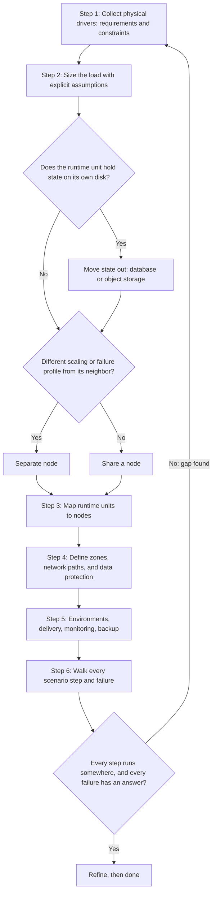
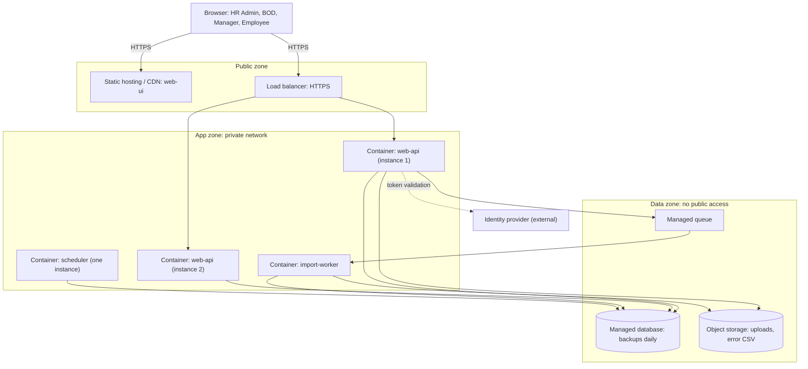

# Physical View: Analysis Method

**Goal:** turn the runtime units (Process view) and the non-functional requirements into a deployment model: which node runs what, how nodes connect, and what the infrastructure must guarantee.
**Input:** runtime unit catalog, deliverables from the Development view, non-functional requirements (users, data volume, availability, security), constraints (budget, cloud provider, compliance).
**Output:** deployment diagram, node catalog, environment list, security zones, capacity and recovery targets.

The method is iterative. Sizing numbers and failure questions usually reveal nodes, storage, and security rules the first diagram hides.

> The process view says **what runs**. The physical view says **where it runs, on what, and what keeps it safe and alive**.

---

## Decision flow

---

## Step 1: Collect physical drivers

Read the use cases, the process view, and the project brief. List:

- **Users:** how many, from where, when (office hours or round the clock).
- **Data:** how much, how fast it grows, how long it is kept.
- **Sensitive data:** personal data, salary, national ID, anything with a legal rule.
- **Availability words:** "always available", "during work hours", acceptable downtime.
- **Performance words:** "real time", "within a few seconds".
- **Integrations:** identity provider, email, file storage, external APIs.
- **Constraints:** budget, cloud provider already chosen, team skills, data location rules.

Do not decide anything yet. When a number is missing, write **"unknown"** and ask the business owner.

---

## Step 2: Size the load

Turn each driver into a number, **and mark every guess as an assumption**.

| Driver              | Number              | Source               | Status         |
| ------------------- | ------------------- | -------------------- | -------------- |
| Employees           | 500                 | HR                   | Confirmed      |
| Concurrent users    | 30                  | Estimate (HR, BOD, managers) | **Assumption** |
| Import file         | 5 MB, 2,000 rows    | Largest current sheet | **Assumption** |
| Records after 5 years | 500 employees x 20 events | Estimate        | **Assumption** |
| Availability        | Working hours, 99%  | Business owner       | Open           |

**Rule of thumb:** a small internal system rarely needs scale. It needs **safety**: backups, access control, and a way to recover. Size for the numbers you have, and pick a design that can grow without a redesign.

---

## Step 3: Map runtime units to nodes

A **node** is something that runs code or holds data: a container, a virtual machine, a managed database, a storage bucket. Take each runtime unit from the Process view and ask **in order**:

| #   | Filter question                                                   | If yes                                          | If no    |
| --- | ----------------------------------------------------------------- | ----------------------------------------------- | -------- |
| 1   | Does it keep important data on its own disk?                      | **Move the data out** (database or object storage), then continue | Continue |
| 2   | Is it a store (database, queue, file storage)?                    | **Managed service** if budget allows, else a dedicated node | Continue |
| 3   | Does it scale or fail differently from another unit?              | **Separate node** (for example API versus worker) | Continue |
| 4   | Otherwise                                                         | **Share a node** with its neighbor              |          |

**Rule of thumb (stateless):** any compute node must be replaceable at any moment. If a node dies and nothing is lost, it can be restarted, scaled, or moved freely. This is the main rule your code must respect.

### Example

| Runtime unit (Process view) | Filter | Node decision                                                         |
| --------------------------- | ------ | --------------------------------------------------------------------- |
| Web API                     | 3      | **Container**, 2 instances behind a load balancer                     |
| Import Worker               | 3      | **Container**, 1 instance, separate: CPU spikes must not slow the API |
| Scheduler                   | 3      | **Container**, exactly one instance (or a platform cron)              |
| Database                    | 2      | **Managed relational database** with automated backups                |
| Job Queue                   | 2      | **Managed queue**, or a table in the database at this scale           |
| File Storage                | 1, 2   | **Object storage bucket.** Not local disk: containers lose it on restart |
| Web UI                      | 3      | **Static hosting or CDN**                                             |

---

## Step 4: Zones, network paths, and data protection

### Zones

Group nodes by what may reach them:

| Zone       | Contains                               | Reachable from                  |
| ---------- | -------------------------------------- | ------------------------------- |
| **Public** | Load balancer, static UI               | The internet                    |
| **App**    | API, worker, scheduler containers      | Public zone only                |
| **Data**   | Database, object storage, queue        | App zone only                   |

**Rule:** only the load balancer faces the internet. The database has **no public address**.

### Paths and protection

For each connection in the diagram, record the protocol and protection:

| Connection              | Protocol | Protection                                      |
| ----------------------- | -------- | ----------------------------------------------- |
| Browser to load balancer | HTTPS   | TLS, modern versions only                       |
| Load balancer to API    | HTTP/HTTPS | Private network                              |
| API to database         | SQL     | Private network, credentials from a secret store |
| API to identity provider | HTTPS  | Token validation                                |

For each kind of sensitive data, record where it is **stored**, **how it is encrypted**, **who can reach it**, and **how long it is kept**. Salary and national ID are the high-value items in the case study.

---

## Step 5: Environments, delivery, monitoring, and recovery

| Topic                 | Decision to record                                                              |
| --------------------- | ------------------------------------------------------------------------------- |
| **Environments**      | Which exist (dev, staging, production), how alike they are, what data they hold |
| **Real data**         | Production data must not be copied to dev or staging without masking            |
| **Configuration**     | Environment variables or a secret store, never in the repository                |
| **Delivery**          | How a build reaches each environment (pipeline, approval, rollback)             |
| **Monitoring**        | Health checks, logs, alerts, who is told                                        |
| **Backup**            | What, how often, where, and **who has restored one**                            |
| **Recovery targets**  | RPO (how much data you may lose), RTO (how long you may be down)                |

Example targets (assumptions, confirm with the business owner): RPO 24 hours, RTO 4 hours, daily database backup kept 30 days, restore tested once per quarter.

---

## Step 6: Walk the scenario (the +1 check)

Take each use case step and exception flow and ask two questions: **where does this run?** and **what if that node dies or fills up?**

| Use case step     | Runs on               | If the node fails                                           |
| ----------------- | --------------------- | ----------------------------------------------------------- |
| 1 Upload          | API, object storage   | Other API instance serves the retry; upload resumes by retry |
| 2 to 3 Map, confirm | API, database       | Database failover; managed service restores in minutes      |
| 4 to 5 Validate, create | Import Worker, database | Job is retried by the new worker (idempotent, see Process view) |
| 6 Summary         | API, database         | UI keeps polling until the API is back                      |
| E-2 Error CSV     | Object storage        | File is regenerated from `RowError` rows                    |
| UC-04 pending salary | Scheduler          | Missed run is picked up by the next daily run               |

Then check every **non-functional requirement** has a mechanism and a way to verify it:

| Requirement                 | Mechanism                                  | Verified by                       |
| --------------------------- | ------------------------------------------ | --------------------------------- |
| Salary visible to BOD only  | App-level masking, database private, TLS   | Access test, network scan         |
| Survive a node loss         | 2 API instances, managed database          | Stop one instance in staging      |
| Recover from data loss      | Daily backup, RPO 24 hours                 | Restore drill                     |

Anything without a node, a failure answer, or a verification is a **gap**. Go back to Step 1. Fill the Physical column of the traceability tables with these answers.

Then re-apply the Step 3 filters to anything debatable (for example, can the worker share a node with the API at this size?) and write the reason next to the diagram.

### Resulting deployment diagram

---

## Quick reference: when decisions happen

| When   | Decision                             | Based on                                          |
| ------ | ------------------------------------ | ------------------------------------------------- |
| Step 1 | What the infrastructure must satisfy | Users, data, sensitivity, availability, constraints |
| Step 2 | How big it must be                   | Numbers, each marked confirmed or assumption      |
| Step 3 | Which node runs each unit            | State, store or compute, scaling and failure profile |
| Step 4 | Zones, paths, protection             | What may reach what; sensitive data handling      |
| Step 5 | Environments, delivery, backup, targets | Delivery needs, RPO and RTO                    |
| Step 6 | Is the model complete?               | Every step has a node and a failure answer; every requirement verified |

**Tip:** write the reason for each judgment call next to the diagram so your team can challenge it later.
