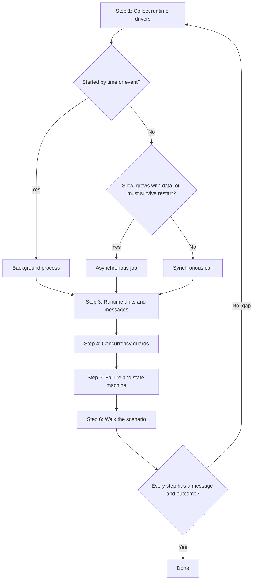

# Process View Guide (4+1 Architecture)

A working guide for building the **Process view** from use cases and the logical model, with ready-to-copy templates for the **runtime classification**, **runtime unit catalog**, **concurrency register**, **decision log**, and **traceability matrix**.

---

## 1. Purpose and scope

| Item                    | Description                                                                                              |
| ----------------------- | -------------------------------------------------------------------------------------------------------- |
| **View**                | Process / Runtime                                                                                        |
| **Question it answers** | What runs at the same time, what waits for what, and what happens when something fails or collides?      |
| **Perspective**         | Integrators, performance engineers                                                                       |
| **Concern**             | Concurrency, performance, scalability, availability                                                      |
| **Input**               | Use cases (+1 Scenario view), logical view (entities and statuses), non-functional requirements          |
| **Output**              | Sequence diagrams, state machines, runtime unit catalog, concurrency register, decision log, traceability |
| **Not covered here**    | Entities (Logical view), module grouping (Development view), servers and networks (Physical view)        |

The process view shows **how the system behaves over time**, not what it stores or where it is installed.

---

## 2. Workflow overview

| Phase | Activity                                                          | Where it is done         | Output                              |
| ----- | ----------------------------------------------------------------- | ------------------------ | ----------------------------------- |
| 1     | Steps 1 and 2: collect drivers, classify sync or async            | Notes (Markdown tables)  | Runtime classification per use case |
| 2     | Step 3: runtime units and messages                                | Mermaid sequence diagrams | Sequence diagram per scenario      |
| 3     | Steps 4 and 5: concurrency, failure, state machine                | Notes, then code         | Concurrency register, state diagram |
| 4     | Step 6: walk the scenario                                         | Traceability table       | Messages linked to use case steps   |
| 5     | Prove it: run the risky scenarios (double click, crash, two users) | Tests                    | Validated behavior                  |
| 6     | Finalize catalog, decision log, traceability                      | `docs/architecture/`     | Documentation set                   |

> **Rule:** write each decision into the decision log **at the moment you make it**. Tidy it in phase 6, but do not wait until then to write it.

---

## 3. The six-step method

### Step 1: Collect runtime drivers

List verbs that mean work, who or what triggers each step, volume and speed words, shared data, and exception flows. Do not decide yet.

### Step 2: Classify each step

Ask in order. Stop at the first question that decides it.

| #   | Question                                                  | If yes                           | If no    |
| --- | --------------------------------------------------------- | -------------------------------- | -------- |
| 1   | Started by time or an event, not by a user?               | **Background process**           | Continue |
| 2   | Can it take longer than a few seconds, or grow with data? | **Asynchronous job**             | Continue |
| 3   | Must it survive a restart or a failure half way?          | **Asynchronous job** (persisted) | Continue |
| 4   | Does the user need the result to continue?                | **Synchronous call**             | Continue |

**Rule of thumb:** work that grows with the amount of data must not run inside a request.

### Step 3: Define runtime units and messages

Group steps into runtime units (web API, worker, scheduler, database, queue, storage). Draw a sequence diagram per scenario with `alt` blocks for exception flows.

### Step 4: Concurrency and consistency

For each shared thing ask: can two touch it at once, what breaks, what is the cheapest guard? Guards: unique constraint, status guard, idempotent handler, version column, transaction per batch, cache invalidation.

### Step 5: Failure, timeouts, and state

For each async step and external call: timeout, retry, partial failure, who is told. Turn the logical status enumeration into a state machine where every transition is caused by a message.

### Step 6: Walk the scenario (the +1 check)

For every use case step and exception flow, point at the message and its failure outcome. Anything missing is a **gap**. Go back to Step 1.

### Decision flow



---

## 4. Working across many use cases

After the last use case, add a **consolidation** activity:

1. **Merge runtime units.** Several use cases usually need the same worker or queue. One "Import Worker" is better than one per use case, unless their scaling or failure needs differ.
2. **Standardize the async pattern.** Pick one way to run jobs (queue, retry policy, status polling) and reuse it. Record it as a decision.
3. **Find cross-use-case collisions.** UC-01 (bulk import) and UC-03 (edit a record) can touch the same employee. Add these to the concurrency register.
4. **Check shared resources.** Database connections, file storage, and the queue are shared by everything. Note limits.
5. **Check performance-critical paths** against the non-functional requirements (for example UC-05 search "in real time", UC-02 profile load).
6. **Re-run the Step 6 check** for every use case against the merged model.

---

## 5. Recommended folder structure

```
docs/architecture/
├── logical-view-guide.md
├── process-view-guide.md          <- this document
├── runtime/
│   ├── UC-01-runtime.md           <- Steps 1 and 2 notes per use case
│   └── UC-02-runtime.md
├── runtime-units.md
├── concurrency-register.md
├── process-decision-log.md
├── traceability.md                <- shared with the logical view
└── diagrams/
    ├── UC-01-sequence.md          <- Mermaid sequence diagrams
    └── migration-job-states.md    <- Mermaid state diagrams
```

---

## 6. Template: runtime classification (Steps 1 and 2, one per use case)

Copy into `runtime/UC-xx-runtime.md`.

```markdown
# UC-xx: <Use case name> - Runtime classification

## Step 1: Drivers found

<verbs, triggers, volume and speed words, shared data, exception flows>

## Step 2: Classification

| Step or flow | Trigger          | Filter that decided (1 to 4) | Classification              | Reason         | Log ref |
| ------------ | ---------------- | ---------------------------- | --------------------------- | -------------- | ------- |
| <step>       | <user / time / event> | <number>                | Sync / Async job / Background | <short reason> | PD-xxx  |
```

---

## 7. Template: runtime unit catalog

Copy into `runtime-units.md`. One row per runtime unit.

```markdown
# Runtime units

| Unit   | Type                                         | Started by                 | Runs (use cases) | Scales by                    | State held           | Notes                      |
| ------ | -------------------------------------------- | -------------------------- | ---------------- | ---------------------------- | -------------------- | -------------------------- |
| <Name> | Web process / Worker / Scheduler / Store / Queue | <request / queue / cron> | UC-xx            | <more instances / bigger / not at all> | <none / database / files> | <limits, open questions> |
```

### Example

```markdown
| Unit            | Type      | Started by      | Runs (use cases)          | Scales by           | State held        | Notes                                  |
| --------------- | --------- | --------------- | ------------------------- | ------------------- | ----------------- | -------------------------------------- |
| Web API         | Web process | HTTP request  | UC-01 to UC-06            | More instances      | None (stateless)  | Sessions in the database or a token    |
| Import Worker   | Worker    | Job queue       | UC-01                     | More instances      | None              | Jobs must be idempotent. See PD-002    |
| Scheduler       | Scheduler | Cron, daily     | UC-04 (activate pending)  | Not at all (one)    | None              | Must be safe if it fires twice         |
| Job Queue       | Queue     | n/a             | UC-01                     | Managed service     | Pending jobs      | Persisted, survives restart            |
| Database        | Store     | n/a             | All                       | Bigger, read replica later | All records | Unique constraints are the arbiter     |
| File Storage    | Store     | n/a             | UC-01                     | Managed service     | Uploads, error CSV | Not local disk. See Physical view     |
```

---

## 8. Template: concurrency register

Copy into `concurrency-register.md`. One row per shared thing and collision.

```markdown
| ID     | Shared thing | Collision scenario    | What goes wrong | Guard                         | Verified by (test) | Log ref |
| ------ | ------------ | --------------------- | --------------- | ----------------------------- | ------------------ | ------- |
| CR-xxx | <data/queue> | <who does what at once> | <consequence> | <constraint / status guard / idempotency / version / transaction> | <test name> | PD-xxx |
```

### Example

```markdown
| ID    | Shared thing       | Collision scenario                              | What goes wrong                 | Guard                               | Verified by (test)            | Log ref |
| ----- | ------------------ | ----------------------------------------------- | ------------------------------- | ----------------------------------- | ----------------------------- | ------- |
| CR-01 | Employee.email     | Two imports contain the same email              | Duplicate employee              | Unique constraint, violation becomes RowError | two-imports-same-email | PD-001  |
| CR-02 | MigrationJob.status | Confirm mapping clicked twice                  | Job processed twice             | Status guard UPLOADED to MAPPED     | double-confirm-runs-once      | PD-002  |
| CR-03 | Import batches     | Worker crashes mid import, job retried          | Duplicate or missing rows       | Batch commit plus idempotent insert | crash-after-batch-3-retry     | PD-002  |
| CR-04 | Employee record    | HR Admin edits while an import updates it       | Lost update                     | Version column                      | concurrent-edit-rejected      | PD-003  |
```

---

## 9. Template: decision log

Copy into `process-decision-log.md`. Newest entry at the bottom. Never delete an entry; mark it superseded.

### Entry template

```markdown
## PD-xxx: <Short title of the decision>

- **Date:** YYYY-MM-DD
- **Status:** Proposed / Accepted / Open / Superseded by PD-yyy
- **Source:** <use case and step, e.g. UC-01 step 4>
- **Method step:** <1 to 6, e.g. Step 2 (Classify: grows with data?)>
- **Question:** <What was being decided?>
- **Decision:** <What was chosen?>
- **Reason:** <Why? Tie it to the use case, a number, or a rule.>
- **Alternatives considered:** <Other options and why they were rejected>
- **Consequences:** <What this changes or restricts>
- **Revisit if:** <The condition that would justify reversing this>
```

### What to log

Log a decision if someone could reasonably ask "why not the other way?":

- A step is async (or sync) and the other choice was plausible
- A guard was chosen for a collision, or a collision was accepted
- A retry, timeout, or partial-failure rule
- A runtime unit was added, merged, or split
- A performance assumption (a number) the design relies on

### Example entries

```markdown
## PD-001: Duplicate emails are resolved by the database, not by a pre-check

- **Date:** 2026-11-20
- **Status:** Accepted
- **Source:** UC-01 step 4
- **Method step:** Step 4 (Concurrency)
- **Question:** How do we stop two imports from creating the same employee?
- **Decision:** Rely on the unique constraint on `Employee.email`. A violation is stored as a `RowError`.
- **Reason:** A "check then insert" pre-check is unsafe when two imports run at once.
- **Alternatives considered:** Table lock during import. Rejected: blocks all HR work.
- **Consequences:** Validation phase only checks format. Uniqueness is final at insert time.
- **Revisit if:** The business owner decides duplicates should update the existing record (see LD-004).

## PD-002: Import runs as an async job with batch commits

- **Date:** 2026-11-20
- **Status:** Accepted
- **Source:** UC-01 steps 4 and 5
- **Method step:** Step 2 (Classify: grows with data?)
- **Question:** Does the import run inside the upload request?
- **Decision:** No. The API enqueues a job. A worker validates and inserts in batches of 100 rows. The UI polls the job status.
- **Reason:** 500+ rows can exceed request timeouts, and a crash must not lose all progress.
- **Alternatives considered:** One big transaction in the request. Rejected: timeouts, and one bad row would roll back everything, which contradicts E-2.
- **Consequences:** Needs a queue, a worker, idempotent inserts, and a status endpoint.
- **Revisit if:** Files stay under about 50 rows in practice.

## PD-003: Employee edits use optimistic versioning

- **Date:** 2026-11-20
- **Status:** Open (waiting for business owner)
- **Source:** UC-03 step 5
- **Method step:** Step 4 (Concurrency)
- **Question:** What if two HR Admins edit the same employee?
- **Decision:** Pending. Current assumption: reject the second save with a clear message.
- **Reason:** Silent overwrite of salary or identity data is worse than asking someone to retry.
- **Alternatives considered:** Last write wins; field-level merge.
- **Consequences if wrong:** Changes the Employee entity (version column) and the edit form.
- **Revisit if:** The business owner answers, or HR reports frequent conflicts.
```

### Tips

| Rule                                    | Why                                                         |
| --------------------------------------- | ----------------------------------------------------------- |
| Record the **number** behind a choice   | "500 rows" explains why async; a feeling does not           |
| Link to a **use case step**             | Tells you what to re-check if the use case changes          |
| Always add **"Revisit if"**             | Shows the decision is conditional                           |
| Allow **Open** status                   | Unanswered questions are the most valuable entries          |
| Mark **Superseded** instead of deleting | Keeps the history                                           |
| Point to the entry from code            | e.g. `// Idempotent on purpose. See PD-002.`                |

---

## 10. Template: traceability

Add these to `traceability.md` (shared with the logical view).

### 10.1 Use case step to message matrix (the +1 check)

This fills the **Process view message** column of the logical view's matrix and adds failure outcomes.

```markdown
## UC-xx: <name>

| Step or flow | Message          | Sync / Async | Runtime unit | Outcome on failure | Guard (CR ref) | Status   |
| ------------ | ---------------- | ------------ | ------------ | ------------------ | -------------- | -------- |
| <step>       | <message name>   | Sync / Async | <unit>       | <what happens>     | CR-xx          | OK / Gap |
```

Example:

```markdown
## UC-01: Import Employee Spreadsheet

| Step or flow        | Message                  | Sync / Async | Runtime unit  | Outcome on failure                    | Guard  | Status |
| ------------------- | ------------------------ | ------------ | ------------- | ------------------------------------- | ------ | ------ |
| 1 Upload file       | uploadFile()             | Sync         | Web API       | Error shown, no job created           |        | OK     |
| 2 Parse and map     | suggestMapping()         | Sync         | Web API       | E-1: job FAILED                       |        | OK     |
| 3 Confirm mapping   | confirmMapping()         | Sync         | Web API       | Repeat call ignored                   | CR-02  | OK     |
| 4 Validate          | importJob() validate     | Async        | Import Worker | RowError stored                       | CR-01  | OK     |
| 5 Create records    | importJob() insert       | Async        | Import Worker | Retry, then job FAILED                | CR-03  | OK     |
| 6 Summary           | getJobStatus()           | Sync         | Web API       | UI keeps polling                      |        | OK     |
| E-1 Malformed file  | alt E-1                  | Sync         | Web API       | Job FAILED, message shown             |        | OK     |
| E-2 Partial failure | alt E-2                  | Async        | Import Worker | COMPLETED_WITH_ERRORS, error CSV link |        | OK     |
```

### 10.2 State transition to message matrix

Every transition in a state machine must be caused by a message, and every status value must be reachable.

```markdown
| Entity       | From     | To       | Caused by message  | Use case flow |
| ------------ | -------- | -------- | ------------------ | ------------- |
| MigrationJob | UPLOADED | MAPPED   | confirmMapping()   | UC-01 step 3  |
```

### 10.3 Decision to use case index

```markdown
| Decision | Title                                 | Status   | Use cases | Runtime units affected |
| -------- | ------------------------------------- | -------- | --------- | ---------------------- |
| PD-001   | Database resolves duplicate emails    | Accepted | UC-01     | Import Worker, Database |
| PD-002   | Import runs as async job              | Accepted | UC-01     | Web API, Import Worker, Job Queue |
| PD-003   | Optimistic versioning for edits       | Open     | UC-03     | Web API, Database      |
```

---

## 11. Completion checklist

**Per use case**

- [ ] Drivers collected (Step 1)
- [ ] Every step classified with a reason (Step 2)
- [ ] Sequence diagram includes every exception flow (Step 3)
- [ ] Every shared thing has a guard or an accepted risk (Step 4)
- [ ] Timeout, retry, and partial-failure rule for every async step (Step 5)
- [ ] State machine matches the logical status enumeration (Step 5)
- [ ] Every step and flow has a message and a failure outcome (Step 6)
- [ ] Judgment calls logged

**Across all use cases**

- [ ] Runtime units merged where scaling and failure needs match
- [ ] One standard async job pattern
- [ ] Cross-use-case collisions in the concurrency register
- [ ] Performance-critical paths checked against numbers
- [ ] Step 6 re-run for every use case against the merged model

**Delivery**

- [ ] Each concurrency register row has a test
- [ ] Crash, retry, and double-click scenarios exercised
- [ ] Runtime unit catalog matches what the Physical view deploys
- [ ] Decision log has no undated or reasonless entries
- [ ] Open decisions have an owner

---

## 12. Common mistakes

| Mistake                                        | Effect                                  | Fix                                          |
| ---------------------------------------------- | --------------------------------------- | -------------------------------------------- |
| Doing bulk work inside a request               | Timeouts, lost work on failure          | Apply filter 2 and 3 in Step 2               |
| Checking then inserting for uniqueness         | Race between two users                  | Let the database constraint decide           |
| Async job that is not idempotent               | Retry creates duplicates                | Design every handler to be safe to repeat    |
| Sequence diagram of the happy path only        | Failures decided in code, by accident   | Draw an `alt` block for each exception flow  |
| Status values with no transition               | Unreachable or stuck states             | Check the state machine in Step 5            |
| Ignoring the scheduler                         | Time-driven work has no owner           | Look for "future date" and "daily" wording   |
| Guessing performance                           | Wrong sync or async choice              | Write the number and its source in the log   |
| Writing the log at the end                     | Reasons are forgotten                   | Log each decision when made                  |
