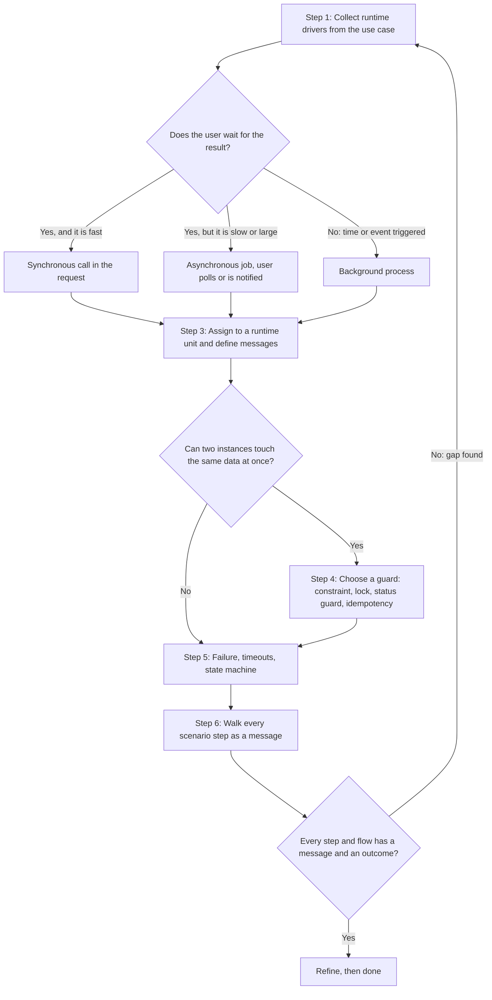
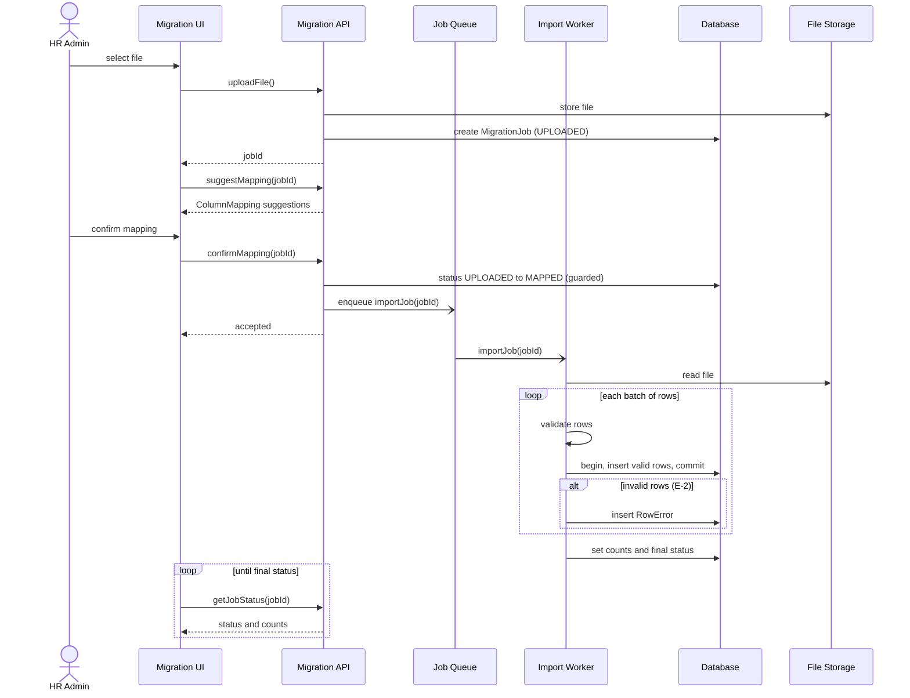
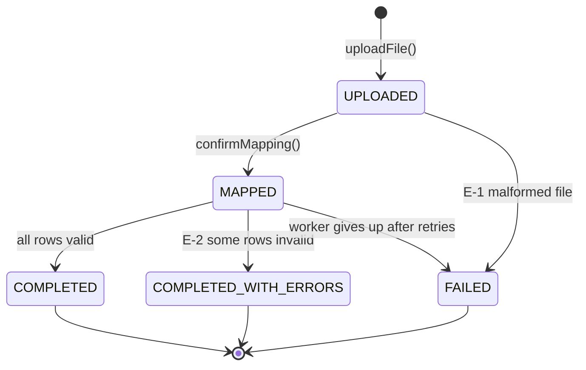

# Process View: Analysis Method

**Goal:** turn a use case (the +1 Scenario view) and the logical model into a runtime model: what runs at the same time, what waits for what, and what happens when something fails.
**Input:** use case text, class diagram (especially status enumerations), non-functional requirements (volume, response time).
**Output:** runtime unit list, sequence diagrams, state machine, concurrency and failure rules.

The method is iterative. Exception flows and "what if two users do this at once?" questions usually reveal runtime units and rules the main scenario hides.

> The logical view says **what exists**. The process view says **what happens, in what order, and what can collide**.

---

## Decision flow

---

## Step 1: Collect runtime drivers

Read the use case and the non-functional requirements. List:

- **Verbs** that mean work (parse, validate, create, render, retrieve).
- **Triggers:** who or what starts each step (a user click, a schedule, another step finishing).
- **Volume and speed words:** "all rows", "real time", "immediately", "500+ rows".
- **Shared things:** data that more than one user or process can reach.
- **Exception flows:** each one is a runtime path that needs an outcome.

Do not decide anything yet.

---

## Step 2: Classify each step (sync, async, background)

Ask these questions **in order** for each step. Stop at the first one that decides it.

| #   | Filter question                                         | If yes                           | If no    |
| --- | ------------------------------------------------------- | -------------------------------- | -------- |
| 1   | Started by time or an event, not by a user?             | **Background process**           | Continue |
| 2   | Can it take longer than a few seconds, or grow with data? | **Asynchronous job**           | Continue |
| 3   | Must it survive a restart or a failure half way?        | **Asynchronous job** (persisted) | Continue |
| 4   | Does the user need the result to continue?              | **Synchronous call**             | Continue |
| 5   | Otherwise                                               | Synchronous, revisit in Step 6   |          |

**Rule of thumb:** work that grows with the amount of data (rows, employees) must not run inside a request. Work that is bounded and the user needs now stays synchronous.

### Example (UC-01: Import Employee Spreadsheet)

| Step                    | Filter that decided | Decision                                                                      |
| ----------------------- | ------------------- | ----------------------------------------------------------------------------- |
| 1 Upload file           | 4                   | **Sync.** Receive and store the file, create the job, return its id           |
| 2 Parse headers and map | 4                   | **Sync.** Reads headers only, bounded size                                    |
| 3 Confirm mapping       | 4                   | **Sync.** Single status change                                                |
| 4 Validate all rows     | 2                   | **Async job.** Grows with row count                                           |
| 5 Create records        | 2, 3                | **Async job.** Same job as step 4; must survive restart, commits in batches   |
| 6 Show summary          | 4                   | **Sync read**, plus the UI polls the job status while steps 4 and 5 run       |
| Other: UC-04 pending salary becomes active | 1 | **Background process.** Daily scheduler activates events whose date has come |

---

## Step 3: Define runtime units and messages

A **runtime unit** is something with its own lifecycle at runtime: a web process, a worker, a scheduler, a database, a queue. Group the classified steps:

| Classification   | Typical runtime unit             |
| ---------------- | -------------------------------- |
| Sync call        | Web API process                  |
| Async job        | Worker process, fed by a queue   |
| Background       | Scheduler (cron) plus a worker   |
| Shared state     | Database, object storage, cache  |

For each scenario, draw a **sequence diagram**: one lifeline per runtime unit (or component that matters), one arrow per message, `alt` blocks for exception flows. Mark each arrow as sync (`->>`) or async (`-)`).

### Resulting sequence diagram (UC-01, main flow and E-2)

---

## Step 4: Concurrency and consistency

For every shared thing from Step 1, ask:

1. **Can two actors or two instances reach it at the same time?**
2. **What goes wrong if they do?** (duplicate, lost update, double processing)
3. **What is the cheapest guard that makes it safe?**

| Problem                          | Guard                                                    | Use when                                   |
| -------------------------------- | -------------------------------------------------------- | ------------------------------------------ |
| Duplicate unique value           | Database unique constraint, handle the violation         | Identity rules (email, national ID)        |
| Same step runs twice             | Status guard: `UPDATE ... WHERE status = 'MAPPED'`       | State machines, double click, retried job  |
| Message delivered twice          | Idempotent handler (safe to repeat)                      | Any queue                                  |
| Lost update on the same record   | Optimistic version column                                | Forms edited by several people (UC-03)     |
| Long multi-step write            | Transaction per batch, record progress                   | Bulk work (UC-01 step 5)                   |
| Read sees a half-done write      | Transaction boundary, or read only final statuses        | Summary, reports                           |
| Stale permission or cached data  | Invalidate on change, or short expiry                    | UC-06 "immediately enforces"               |

### Example conflicts

| Scenario                                          | Risk                              | Guard                                                         |
| ------------------------------------------------- | --------------------------------- | ------------------------------------------------------------- |
| Two HR Admins import files with the same email     | Both pass validation, both insert | Unique constraint on `Employee.email`; violation becomes a `RowError` |
| HR Admin double clicks "confirm mapping"            | Job enqueued twice                | Status guard: only `UPLOADED` to `MAPPED` succeeds once       |
| Worker crashes after batch 3                      | Rows 1 to 300 inserted, rest not  | Batch commits; on retry skip rows that already exist (idempotent) |
| Two HR Admins edit the same employee (UC-03)      | Last write silently wins          | Version column; second save is rejected with a message        |

---

## Step 5: Failure, timeouts, and state

For every async step and every external call, decide:

| Question                         | Decision to record                                   |
| -------------------------------- | ---------------------------------------------------- |
| How long may it take?            | Timeout value, and what happens when it expires      |
| What if it fails?                | Retry (how many, with what delay) or mark `FAILED`   |
| What if it fails half way?       | Roll back, or keep the partial result and say so     |
| Who is told?                     | Status field, error record, notification             |

Turn the logical model's status enumeration into a **state machine**. Every transition must be caused by a message from Step 3.

### Example: `MigrationJob` states

A state with no incoming message, or a status the logical model lacks, is a **gap**. Go back to Step 1 (or fix the logical view).

---

## Step 6: Walk the scenario (the +1 check)

Take each use case step and exception flow and point at the **message** that performs it and the **outcome** when it fails.

| Use case step     | Process view message           | Sync / async | Runtime unit    | Outcome on failure                  |
| ----------------- | ------------------------------ | ------------ | --------------- | ----------------------------------- |
| 1 Upload          | `uploadFile()`                 | Sync         | Web API         | Error shown, no job created         |
| 2 Parse and map   | `suggestMapping()`             | Sync         | Web API         | E-1: job `FAILED`                   |
| 3 Confirm         | `confirmMapping()`             | Sync         | Web API         | Repeat call is ignored (status guard) |
| 4 Validate        | `importJob()` (validate phase) | Async        | Import Worker   | E-2: `RowError` stored              |
| 5 Create records  | `importJob()` (insert phase)   | Async        | Import Worker   | Retry, then job `FAILED`            |
| 6 Summary         | `getJobStatus()`               | Sync         | Web API         | UI keeps polling                    |

Anything without a message or an outcome is a gap. Fill the **Process view message** column of the logical view's use case to model matrix with these names.

Then re-apply the Step 2 filters to anything debatable (for example, can step 2 stay synchronous once files reach 50 MB?) and write the reason next to the diagram.

---

## Quick reference: when decisions happen

| When   | Decision                                      | Based on                                           |
| ------ | --------------------------------------------- | -------------------------------------------------- |
| Step 1 | What drives the runtime behavior              | Verbs, triggers, volume words, shared data         |
| Step 2 | Sync, async, or background                    | Trigger, duration, survival, whether user waits    |
| Step 3 | Runtime units and messages                    | Grouping of classified steps, sequence diagrams    |
| Step 4 | Guard against collisions                      | "Can two touch this at once, and what breaks?"     |
| Step 5 | Timeouts, retries, state machine              | Failure of each async step, status enumeration     |
| Step 6 | Is the model complete?                        | Every step and flow has a message and an outcome   |

**Tip:** write the reason for each judgment call next to the diagram so your team can challenge it later.
